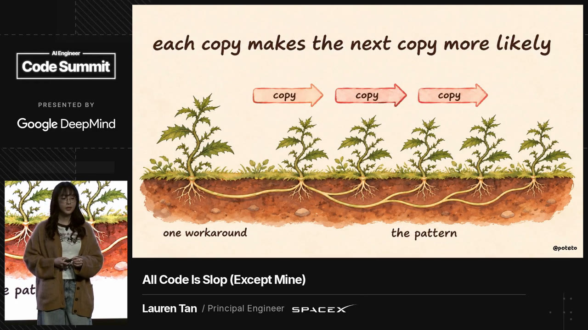
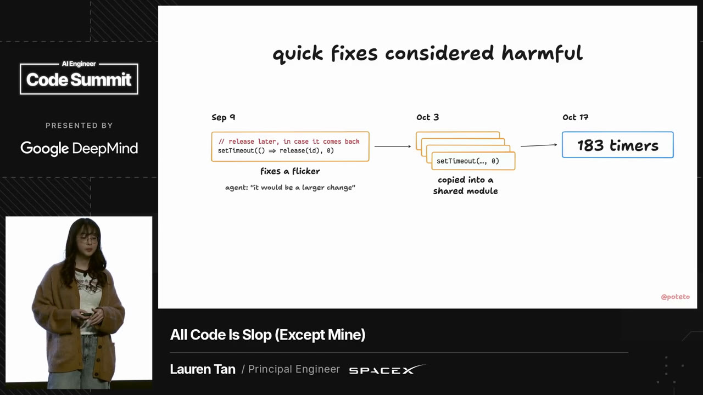
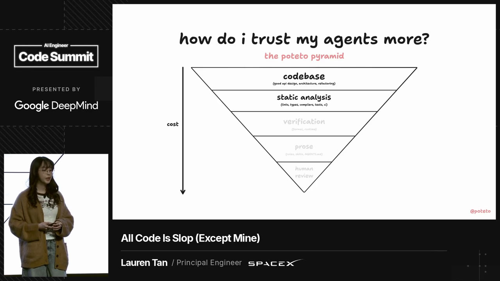
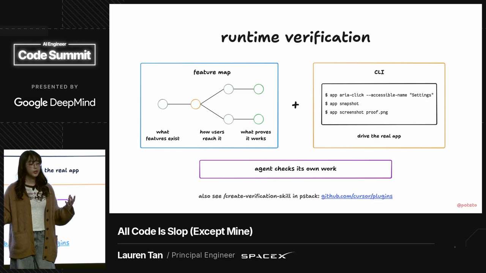
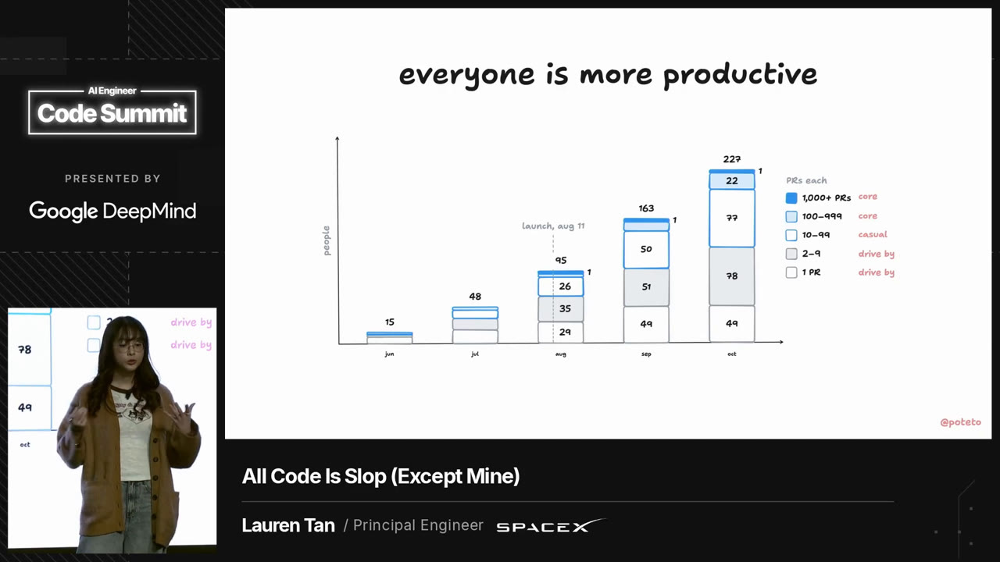
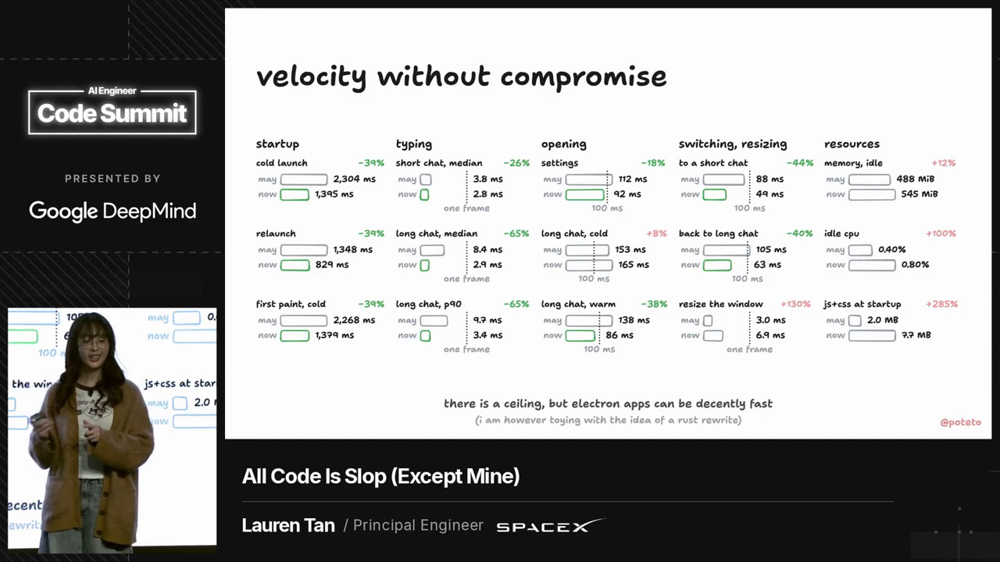

# From "AI Slop" to 11,000 Merged PRs a Month: A Deep Evaluation and Adoption Guide of Lauren Tan's AI Coding Engineering System (Staff Engineer, SpaceXSI)

> **A note on the subject and sources**: the video [《SpaceX 主任工程師教你：讓 AI 少寫垃圾》](https://www.youtube.com/watch?v=OPAdcgNb4ts) circulating in the Chinese-speaking tech community (channel Agent 煉金術士, 2026-11-18) is derived from the public talks of **Lauren Tan (online handle `@poteto`)**, Staff Engineer at **SpaceX Superintelligence (SpaceXSI)**. Lauren Tan previously served on the core team of Meta's React Compiler (see her [AI Engineer speaker profile](https://ai.engineer/speakers/lauren-tan)) and later led the architecture evolution of GrokBot, the multi-agent desktop product under Cursor and SpaceXSI. This article integrates her two first-party English sources — the AI Engineer CODE 2026 keynote [All Code Is Slop (Except Mine)](https://www.youtube.com/watch?v=O_zcc6Xl12g) (2026-11-14, [official transcript page](https://ai.engineer/code/2026/talks/lauren-tan)) and the 55-minute deep interview [SpaceX AI Engineer: Stop Using AI Agents Like This](https://www.youtube.com/watch?v=u1hqfjrMhwQ) (2026-09-26) — and cross-examines them against her open-source skill library [`pstack`](https://github.com/cursor/plugins/blob/main/pstack/README.md).

---

## Part 1: Lauren Tan's theory, engineering practice, and verified results

### 1.1 The core thesis: AI doesn't produce slop — AI is a hundred-fold amplifier of the codebase's environment

Opening her [AI Engineer CODE 2026 keynote](https://www.youtube.com/watch?v=O_zcc6Xl12g), Lauren Tan offers a counter-intuitive observation: the "AI slop" engineers complain about is, at its root, often just "code I didn't write". Long before the AI era, giants like Meta and Google were already fighting "human slop"; what made LLMs blow the problem out of proportion is that **the codebase itself is the agent's largest context input**.

* **Codebase as a garden**: in 2024 an engineer reviewed 3 PRs a day from colleagues; today 300 agent PRs pour in daily. Code no longer arrives as discrete patches — it grows like a living organism. If the codebase keeps a temporary workaround or a deprecated pattern around, the next agent will mistake it for "the team's established convention" and replicate it rapidly, turning into uncontrolled weeds.
* **The cautionary tale — 183 timers spreading in 5 weeks**: Lauren Tan disclosed a real incident in the Cursor client. Because the imperative style of the underlying VS Code clashed architecturally with React's declarative style, agents took to "papering over" UI flicker with imperative timers — `setTimeout`, `requestAnimationFrame`, `requestIdleCallback`. The first appeared on September 9; by October 3 it had been copied into a shared module; by October 17 — just over five weeks — there were **183 timers**, whose high-frequency creation and destruction triggered severe garbage-collection (GC) stalls that crippled desktop performance.
* **The new meta-problem of engineering**: the software engineer's core responsibility has shifted from "typing code by hand" to **"keeping — or even raising — code quality while output grows a hundred-fold"**. The key is not fancier prompts but building a high-trust deterministic engineering environment around the agent.



*Figure 1: the weed-spread mechanism of "codebase as a garden" — one temporary workaround hardens into "the pattern" after three copies; a graphical rendering of the broken-windows effect (keynote video frame at 04:30, AI Engineer official channel)*



*Figure 2: "quick fixes considered harmful" — the incident timeline of 183 timers spreading in five weeks: fix one flicker → copied into a shared module → spreads everywhere (keynote video frame at 07:50)*

### 1.2 The core theoretical framework: the inverted trust pyramid and the trust curve

Lauren Tan arranges every investment used to correct agent behaviour into an **Inverse Trust Pyramid**, ordered by "determinism strength" and "marginal cost per intervention", in four layers from top (broadest, cheapest, hardest) to bottom (narrowest, most expensive, most fragile):

| Layer | Core means | Nature of constraint | Typical vehicles | Engineering principle |
| :--- | :--- | :--- | :--- | :--- |
| **Layer 1 (top / strongest)** | **Codebase and API design** | Physical determinism | Framework abstractions, directory topology, banning high-risk APIs | Make "the shortest path the correct path", so wrong usage cannot even be written |
| **Layer 2 (strong constraint)** | **Static analysis and deterministic checks** | Mechanical determinism | Custom lint rules, strong typing, dependency-graph checks, unit tests | Every time you correct an agent, solidify it first into a deterministic rule that turns CI red |
| **Layer 3 (behavioural evidence)** | **Runtime and formal verification** | Evidence-grade verification | CDP-driven tools, Feature Map, TLA+, Lean 4, Bombadil | Code review shrinks from "reading code line by line" to "reviewing verification artefacts (videos / screenshots / state diagrams / proofs)" |
| **Layer 4 (bottom / weakest)** | **Natural-language rules and human review** | Probabilistic soft constraint | `AGENTS.md`, Skills, human PR review | Keep only the few principles that need human subjective judgement; human review is the most expensive bottleneck |



*Figure 3: the "the poteto pyramid" slide from the keynote — cost increases top-down and determinism decreases top-down: codebase → static analysis → verification → prose → human review, matching the four layers in the table above (keynote video frame at 02:30)*

In [the 55-minute September interview](https://www.youtube.com/watch?v=u1hqfjrMhwQ) she further sketches the maturity ladder of the **Trust Curve**: an engineer must never spin up hundreds of parallel cloud agents while still not trusting a single agent (otherwise you are just burning tokens in a high-speed slop factory); instead you must climb in order through **"local strong-intervention observation (Backseat Driver) → solidify deterministic checks and verification skills → extend to cloud background agents (such as Benny, which auto-reproduces Slack bugs) → gradually enable auto-merge"**.

### 1.3 Five signature engineering practices

1. **The Dune framework and "eliminating errors by category"**: Dune is the in-house framework built for the Electron desktop product GrokBot (think Next.js for Electron), held to one iron rule — **"anything that requires nuance to use well often leads to slop"**. The team **banned React `useEffect` outright** in product code (reserved for framework internals only), permanently erasing an entire class of race conditions and memory leaks from the code-review checklist. Leveraging "context through directory structure", they set top-level `electron-main` and `electron-renderer` directories, with a dependency-graph analyzer and lint rules strictly forbidding cross-process imports in CI, keeping heavy computation off the 60 FPS (16ms/frame) render main thread.
2. **Cutting 99% of code comments (banning comment slop)**: GrokBot had accumulated over 65,000 comments; the team slashed them to roughly 1,200. Lauren found that AI excels at appending an erudite-looking comment justifying a terrible hotfix as "necessary". Later agents read those comments, treat them as "inviolable historical edicts", and keep copying the broken pattern. Comments rot easily and cannot be enforced by a compiler; what actually works is deleting the comment and replacing it with a **custom lint error carrying precise repair instructions**, forcing the agent to fix the root cause.
3. **The snowball effect of deterministic checks**: the team kept the rule "every time an agent makes a mistake, solidify one deterministic rule". From **7** custom checks in July 2026 to **167** accumulated by November. As coverage became comprehensive enough, the human review checklist kept shrinking until reaching the tipping point of "almost no code left to review — only verification artefacts".
4. **Verification-first and "the golden age of verification"**:
   * **Runtime self-verification and the Feature Map**: she wrote standalone CLI tools and skills wrapping the Chrome DevTools Protocol (CDP) or the iOS Simulator (such as `control-glass`), letting agents launch the app themselves and capture CPU flame graphs and heap snapshots. To fix agents not understanding "that thing in the left sidebar", she introduced the **Feature Map** — a structured dictionary describing every UI entry point, keyboard shortcut and DOM selector from the user's perspective, sharply cutting exploration token spend.
   * **Democratizing formal verification and UI property testing**: **TLA+** model-checks core user flows such as cross-device notifications; **Lean 4** proves the algorithm invariant of "scrolling without flicker/jank" for the in-house virtual scrolling list library; Antithesis's open-source [**Bombadil**](https://github.com/antithesishq/bombadil) runs autonomous exploratory property-based testing against the web/desktop UI; and the `statechart` skill in `pstack` visualizes user-visible state machines, paired with screen recordings and screenshots for human review.
   * **The inverted token budget**: Lauren cites frontline feedback from well-known engineer Cindy Sridharan (also collected in the [Martin Fowler column](https://martinfowler.com/fragments/2026-11-10.html)) — today **70% of the daily token budget goes to verifying patches, with only 20–30% generating code**. Because agents slash the human cost of writing TLA+/Lean/property tests, software engineering is entering "the golden age of testing and verification".
5. **Skill engineering (`pstack`) and the anti-cheating eval loop**: Lauren open-sourced her personal workflow as the official Cursor plugin [`pstack` (Potato Stack)](https://github.com/cursor/plugins/blob/main/pstack/README.md) (already ported to other ecosystems, e.g. a [Claude Code port](https://github.com/PickleBoxer/pstack)), containing the router `/poteto-mode`, root-cause skills `how`/`why`, architecture planning via `architect`, and 23 engineering principles. To prevent skill degradation she designed a strict **Eval Playbook**: a coordinator agent generates the rubric; subagents run concurrently in **deliberately obfuscated, independently named directories** (so agents don't detect "being evaluated" and change behaviour); then **judge agents on different base models** cross-score the results, paired with `/loop` for continuous hill-climbing.



*Figure 4: the keynote slide for practice #4 above, "verification-first" — the Feature Map (what features exist / how users reach it / what proves it works) plus verification CLIs (launch the real app, capture screenshots and snapshots) form the self-verification loop of "agent checks its own work"; the slide footer also credits the runtime-verification skill in pstack (keynote video frame at 10:45)*

### 1.4 Verified engineering results and honest boundaries

Per the frontline production data disclosed in the [AI Engineer CODE 2026 keynote](https://www.youtube.com/watch?v=O_zcc6Xl12g) and the [official transcript page](https://ai.engineer/code/2026/talks/lauren-tan), after six months of environment infrastructure investment the GrokBot team delivered the following report card in October 2026:

* **Throughput leap**: Lauren's personal monthly merged PRs jumped from **68** in March to **3,127** in October (about 100 PRs/day); the whole GrokBot team merged **10,926 (roughly 11,000) PRs** in October (about 350 PRs/day), with stable-release cadence rising to roughly daily.
* **Cross-functional empowerment, safely**: **227 contributors** submitted at least one PR in October, including many product managers, designers and even GTM staff unfamiliar with the underlying code — the strict Dune architecture and CI gates absorbed the complexity so non-engineers could contribute production code safely.
* **Quality and performance metrics**: the revert rate went down, not up — from **0.98%** in June to **0.47%**, stabilizing around 0.5% (from roughly 1 revert per 100 PRs to 1 per 200); cold start improved from **2.3s** to **1.4s**, with typing latency, new-conversation and conversation-switch speed all markedly better.
* **A sober look at the boundaries**: three limitations must be stated objectively — first, Lauren candidly showed the **regressed items** in the same performance table (memory up, window-resize slower) rather than cherry-picking; second, as the [AI Engineer commentary](https://ai.engineer/code/2026/talks/lauren-tan) reminds us, this is a single team's production report, **not a controlled experiment**; third, in the [September interview](https://www.youtube.com/watch?v=u1hqfjrMhwQ) she admits to having "a nearly unlimited token allowance" inside an AI lab — ordinary teams should phase adoption by ROI and must not copy the full cloud automation wholesale.



*Figure 5: "everyone is more productive" — active contributors stacked by monthly PR output: the team grew from 15 people in January to 227 in October, 22 of whom each merged 100+ PRs in October (keynote video frame at 14:05)*



*Figure 6: "velocity without compromise" — the full performance ledger, May vs. October 2026: cold start 2,304ms→1,395ms (-39%), long-session typing latency -65%, while honestly marking regressions like memory +12%, idle CPU +100%, window resize +130% (keynote video frame at 14:55)*

---

## Part 2: The deep evaluation — do academic papers and industry evidence actually support these practices?

To test whether Lauren Tan's practices are "a Silicon Valley giant's personal feel" or "engineering science with generalizable laws", the table below cross-checks her six core claims against peer-reviewed papers, arXiv preprints and large-scale industry studies published in 2024–2026:

| Lauren Tan's core claim | Support strength | Academic papers and industry evidence | Core conclusion and limitations |
| :--- | :--- | :--- | :--- |
| **1. Write fewer `AGENTS.md` files, write more deterministic code checks** | **Strong support** | The ETH Zurich & LogicStar AI paper [Evaluating AGENTS.md (`arXiv:2602.11988`)](https://arxiv.org/html/2602.11988v1) measured that hand-written context files improve success rates by only **+4%** on average, while **LLM-generated `AGENTS.md` files actually degrade performance by -3%** — and both raise inference cost **by more than 20%**. Another large-scale study ([`arXiv:2611.02383`](https://arxiv.org/html/2611.02383v1)) found **40.4%** of instruction files were never maintained after their first write, 16.1% of multi-format rules conflicted, and roughly 70% lacked security and performance constraints. | Strongly confirms that "natural-language rule files have low ROI and rot easily" — keep only a minimal build-command and tool index, and sink iron rules into code and CI. |
| **2. Static analysis, type systems and lint feedback loops measurably cut errors** | **Strong support** | [Static Analysis as a Feedback Loop (`arXiv:2508.14419`)](https://arxiv.org/abs/2508.14419) shows that wiring static-analysis tools into an iterative feedback loop reduces readability violations of LLM-generated code by **up to 74%**, reliability warnings **up to 44%**, and security vulnerabilities **up to 32%**. [LLMLOOP (`arXiv:2603.23613`)](https://arxiv.org/abs/2603.23613) further validates a five-stage iterative loop combining compilation, static analysis and tests, improving both code and test quality. | Static analysis and compiler feedback are today's best-evidenced, best-value AI-coding quality levers. |
| **3. The broken-windows effect: codebase hygiene directly determines AI output quality** | **Strong support** | [GitClear's 2025–2026 annual code-quality reports](https://www.gitclear.com/the_ai_code_quality_maintainability_gap) (tracking 211M–623M lines of changes) show that after AI adoption, duplicated code blocks surged **+81%** (clone blocks at 4x baseline), copy-paste within commits rose **+41%**, defensive structures masking errors rose **+47%**, two-week churn doubled from 3.3% to **5.7%–7.1%**, and refactor-style moved code collapsed by 70%. | Fully confirms that AI amplifies the entropy already present in a codebase; without clearing old debt (weeding), AI will only replicate bad patterns a hundred times faster. |
| **4. Human line-by-line code review fails; the shift must be to verification artefacts** | **Strong support** | The [METR 2025 randomized controlled trial](https://metr.org/blog/2025-07-10-early-2025-ai-experienced-os-dev-study/) shows experienced open-source developers were **19% slower** using early AI tools on mature repositories (while believing they were 24% faster) — the time sink was precisely human review and correction. The paper [Programmers Are Poor and Overconfident Judges of LLM-Generated Code (`arXiv:2607.08885`)](https://arxiv.org/html/2607.08885v1) further confirms that developers' naked-eye judgement of AI code is both inaccurate and overconfident. | Confirms that "using humans as verifiers" inevitably becomes the bottleneck with high miss rates; shifting to automated runtime evidence review is the direction of travel. |
| **5. Ban 99% of code comments to stop "justification" from spreading** | **Moderate-to-strong support (context-dependent)** | The paper [Identifying Inaccurate Descriptions in LLM-generated Code Comments (`arXiv:2406.14836`)](https://arxiv.org/abs/2406.14836) finds that even the best LLMs produce comments where about **20%** contain falsifiable errors; [Can Adversarial Code Comments Fool AI Security Reviewers (`arXiv:2602.16741`)](https://arxiv.org/pdf/2602.16741) directly demonstrates that comment content can deceive and mislead downstream LLM reviewers. | Academia confirms that "inaccurate or defensive comments poison LLMs", but a blanket 99% comment ban is an aggressive engineering style; complex financial/algorithmic code still needs documentation verified by tests or contracts. |
| **6. Bringing TLA+ / Lean 4 / UI property testing into everyday development** | **Frontier exploration (high potential, lacking large-sample controls)** | Academia is advancing rapidly on LLM-assisted formal verification: [APOLLO (`arXiv:2505.05758`)](https://arxiv.org/abs/2505.05758) and [Intent-aligned Formal Spec Synthesis (`arXiv:2604.10392`)](https://arxiv.org/pdf/2604.10392) demonstrate LLM + Lean 4 co-automated proving; in industry, [Antithesis Bombadil](https://github.com/antithesishq/bombadil) already runs UI property tests, and the [Martin Fowler column](https://martinfowler.com/fragments/2026-11-10.html) also confirms the enterprise trend of "verification tokens far exceeding generation tokens (70% vs 30%)". | The direction is highly forward-looking, but Lauren herself stresses it "remains experimental, by no means a silver bullet" — for now it best suits high-value core algorithms and critical state machines, not bulk CRUD code. |

**Overall evaluation**: Lauren Tan's core architectural methodology (the pyramid's top three layers: strongly-constrained architecture/API → deterministic static-analysis loops → automated runtime verification) **is backed by exceptionally solid academic papers and large-scale industry data**; her outer-ring radical practices (the 99% comment ban, full auto-merge, everyday Lean/TLA+) are a frontier-engineering hacker route built atop very high infrastructure maturity, and should be phased and trimmed on adoption.

---

## Part 3: Comparison with the "AI Coding Evolution Survey (2026-11-16)"

Placing Lauren Tan's (SpaceXSI) frontline practice side by side with the earlier survey [The AI Coding Evolution and Architecture Governance Survey (2026-11-16)](https://co-arising.github.io/articles/ai-coding-evolution-20261116/) (covering the evolution from Vibe Coding, multi-agent roleplay and SDD/Plan Mode to Harness Engineering, plus the four technology schools) reveals strong strategic resonance — and makes her unique contributions and capability boundaries clearly identifiable.

### 3.1 Five core challenges where the two strongly corroborate each other

1. **The broken-windows effect and "poor code begets poorer code"**: the 11/16 survey cites the Thoughtworks Radar and GitClear data showing AI imitates degraded patterns already in the codebase, forming an entropic positive-feedback death spiral; Lauren's gruesome incident of 183 timers spreading in five weeks in Cursor supplies the most concrete frontline evidence.
2. **The failure of soft prompts and long-form Markdown specs**: the 11/16 survey dissects the "Markdown review hell" of GitHub Spec-Kit and AWS Kiro, plus Chris Richardson's "agents arguing on behalf of bad code"; Lauren's metaphor — "pinning 'use less salt' notes on the restaurant wall beats nothing, but swapping in a fixed-measure salt spoon beats them all" — and the inverted pyramid's demotion of `AGENTS.md` to the bottom layer, converge exactly with [Anthropic's official best practices](https://code.claude.com/docs/en/best-practices): rules that keep being missed despite repeated emphasis must move into a hook.
3. **Engineering Ashby's Law of Requisite Variety into practice**: the 11/16 survey cites Birgitta Böckeler's [Harness Engineering](https://martinfowler.com/articles/harness-engineering.html): the only way to govern an LLM's unbounded degrees of freedom is "variety reduction through predefined topologies"; Lauren's `useEffect` ban in Dune, fixed directory boundaries and unified feature slots are a textbook frontend/desktop implementation of Ashby's Law.
4. **Humans become the verification bottleneck; the review perspective shifts**: the 11/16 survey notes "writing code is no longer the bottleneck — reading code is"; Lauren likewise admitted in the September interview that "early on, I was the biggest bottleneck", ultimately upgrading human review from line-by-line diffs to reviewing videos, screenshots, state diagrams and proofs.
5. **The clean division between "deterministic toolchain vs. probabilistic Skills"**: the 11/16 survey distills "zero-tolerance rules go into the compiler/hooks; fuzzy cognition goes into Skills/blind-review subagents"; Lauren likewise builds dependency checks, API bans and CDP-driven CLIs into deterministic code, while packaging investigation workflows, architecture planning and state-diagram generation into `pstack` skills.

### 3.2 Four unique engineering findings from Lauren Tan

Where the 11/16 survey focuses on macro architecture and backend domain modeling, Lauren Tan returned from the high-frequency client/desktop front line with four particularly sharp findings:

1. **Comments as the agent's justification escape hatch**: the industry mostly discussed comments rotting for human readers; Lauren keenly pointed out that agents actively write comments to "launder" lazy hacks, inducing later agents to treat them as canon.

2. **The Feature Map bridges the semantic gap between "vague human UI descriptions" and "code location"**: when a user throws a screenshot and three question marks into Slack, or complains "the button in the left sidebar is laggy", a pure-AST code graph cannot map user-perceived interaction paths; a Feature Map maintained in the repository gives the agent a shared business vocabulary.
3. **The 70% verification-token inversion marks an "economics inflection point for formal methods"**: TLA+ and Lean used to belong to aerospace or distributed-database kernels (like AWS); Lauren shows that once agents ghost-write verification specs, even frontend virtual-list components and cross-device notification flows cross formal verification's cost break-even line.
4. **Eval awareness — the "anti-detection blind test"**: while building `pstack`'s Eval Playbook she discovered that if test directory names contain `eval` or `test`, frontier models detect they are being assessed and deliberately pander; you must use obfuscated directory names plus cross-model blind-review judges to measure real capability.

### 3.3 Positioning the relationship: "elaborate expansion" or "structural complementarity"?

By the harness trichotomy cited in the 11/16 survey (Maintainability Harness / Architecture Fitness Harness / Domain Behaviour Harness), the relationship between the two is not a simple substitution but a precise "one vertical, one horizontal" pairing:

| Dimension | The 11/16 survey's core direction (e.g. Co-arising / JDomInO / FAOS) | Lauren Tan's SpaceXSI / GrokBot practice | Relationship |
| :--- | :--- | :--- | :--- |
| **Core battlefield** | Complex enterprise backends, finance/manufacturing distributed systems (DDD / CQRS / Event Sourcing / Saga) | High-interaction desktop/frontend apps (Electron / React / TypeScript) | **Complementary scenarios** |
| **Code shape and static guardrails** | Abstract principles (ArchUnit, CodeScene, `Stop Hook`) | granular field patterns (7 → 167 lint rules, `useEffect` ban, directory-level process isolation, self-healing errors) | **Elaborate expansion** |
| **Runtime and behavioural verification** | Calls for a Domain Behaviour Harness but says little about end-to-end interaction verification | A complete verification arsenal (CDP CLI, Feature Map, Bombadil UI property tests, Statechart, TLA+/Lean 4) | **Strong supplement** |
| **Global business semantics and bidirectional anchoring** | Locks cross-service business invariants via the domain metamodel compiler (`truthsrc` → knowledge graph → deterministic skeleton + `@CoArisingNode` bidirectional anchoring + cloze fill-in) | Relies mainly on framework conventions, single-directory feature cohesion and localized TLA+; does not touch cross-microservice distributed transactions or bidirectional metamodel compilation | **Core complementarity** |

In one sentence: **on "single-repo code hygiene, static-analysis loops and runtime interaction verification", Lauren Tan is the ultimate elaborate expansion of the Harness Engineering route in the 11/16 survey; on "cross-context complex domain modeling, deterministic skeleton generation and knowledge–code bidirectional anchoring", the two together form the complete puzzle from complex backend business cores to high-frequency frontend delivery.**

---

## Part 4: The project adoption field guide (architecture route, toolchain, and ready-to-reuse samples)

Never jump straight into building an "unattended software factory". As Lauren Tan repeatedly warns: **if the inner loop produces slop, outer-loop automation just produces slop ten times faster.** Adopt progressively in your own project through the following four stages.

### 4.1 The four-stage adoption roadmap

1. **Stage 0: clean the broken windows and set baseline gates (weeks 1–2)**
   * Clean out the 3–5 classes of legacy anti-patterns most often copied by AI (or explicitly isolate `legacy/` in directory naming and forbid new code from importing it).
   * Slim `AGENTS.md` / `CLAUDE.md` to **under 100 lines**, keeping only build/test commands, a directory index and pointers to absolute prohibitions (following [OpenAI's Harness Engineering](https://openai.com/index/harness-engineering/) "directory, not encyclopedia" principle).
2. **Stage 1: sink every manual correction into a deterministic check (weeks 3–6)**
   * Establish the team iron rule: **whenever the same class of mistake is called out a second time in PR review, it must become a lint rule, a type constraint, an architecture test or a hook script — never a bolded reminder in a prompt.**
   * Write **agent-facing self-healing error messages (actionable error messages)** for every custom rule — telling the agent directly "why this is wrong + which sanctioned API to use instead".
3. **Stage 2: close the runtime verification loop and build the Feature Map (months 2–3)**
   * Write a structured `FEATURE_MAP.md` / `feature-map.json` for the project, and wrap a reusable verification CLI (so the agent can launch the local service, run E2E/CDP screenshots or capture performance traces with one command).
   * Pilot property testing (frontend via `Bombadil`; backend via `Hypothesis`/`jqwik`/`ScalaCheck`) or lightweight TLA+ specs on core state machines, money flows or concurrent algorithms.
4. **Stage 3: open the background outer loop and controlled autonomy (month 3 and beyond)**
   * Only after the inner loop's first-pass PR rate and CI interception precision stabilize, introduce background cloud agents for automatic bug reproduction, dependency upgrades, periodic architecture garbage collection (GC PRs) and pre-release auto-fuzzing.

### 4.2 The cross-stack recommended toolchain matrix

| Defense layer | TypeScript / React / Electron | Java / Scala / Kotlin (JVM) | Rust / Go | Python |
| :--- | :--- | :--- | :--- | :--- |
| **Architecture and dependency boundaries** | [`dependency-cruiser`](https://github.com/sverweij/dependency-cruiser), ESLint `no-restricted-imports`, Biome | [`ArchUnit`](https://www.archunit.org/), Spring Modulith, WartRemover | Rust workspace crate boundaries, `depguard` (Go) | [`import-linter`](https://import-linter.readthedocs.io/), Ruff |
| **High-risk API and style locking** | TypeScript `strict: true`, custom ESLint AST rules | Error Prone, SpotBugs, Scala 3 strong typing and `opaque type` | `clippy::deny`, `unsafe` ban, `golangci-lint` | `mypy --strict` / `pyright`, Ruff |
| **Runtime and interaction self-verification** | Chrome DevTools Protocol (CDP), Playwright CLI | Testcontainers, WireMock, JFR performance sampling | `cargo nextest`, `go test -race` | `pytest` + Playwright / `cProfile` |
| **Property testing and formal methods** | [`Bombadil`](https://github.com/antithesishq/bombadil) (UI), `fast-check`, TLA+ / Lean 4 | `jqwik` / `ScalaCheck`, TLA+ | `proptest`, `Kani` / `Verus` | `Hypothesis`, CrossHair |
| **Agent harness control** | Claude Code hooks (`PreToolUse`/`Stop`), Cursor [`pstack`](https://github.com/cursor/plugins/blob/main/pstack/README.md) | Same, plus a domain metamodel compile-time validator (e.g. Co-arising / JDomInO) | Same, plus a Cargo check hook | Same, plus Ruff/Pytest hooks |

### 4.3 Four ready-to-reuse core engineering samples

#### Sample 1: agent-facing "self-healing" architecture prohibition config (ESLint + dependency-cruiser)

The essence: **the error message is not a cold warning for humans — it is a repair directive issued directly to the agent**:

```javascript
// eslint.config.mjs — ban high-risk APIs and isolate the Electron process boundary
export default [
  {
    files: ["src/features/**/*.{ts,tsx}"],
    rules: {
      // 1. Eliminate errors by category: ban useEffect at the feature layer; framework internals only
      "no-restricted-imports": [
        "error",
        {
          paths: [
            {
              name: "react",
              importNames: ["useEffect"],
              message:
                "[AGENT-FIX] Product code must not use useEffect directly. For data-stream subscriptions use useLiveQuery from @framework/query; for event responses move the logic into an event handler.",
            },
          ],
          patterns: [
            {
              group: ["**/electron-main/**"],
              message:
                "[AGENT-FIX] Do not import main-process (electron-main) code from the renderer process (electron-renderer/features). Define type-safe IPC channels in src/ipc/contracts.ts and call through those.",
            },
          ],
        },
      ],
      // 2. No imperative timers as hotfixes
      "no-restricted-globals": [
        "error",
        {
          name: "setTimeout",
          message:
            "[AGENT-FIX] Never bypass state synchronization or flicker with raw setTimeout. Investigate the state-machine root cause, or use the testable controlled clock provided by @framework/scheduler.",
        },
      ],
    },
  },
];
```

#### Sample 2: a user-perspective `FEATURE_MAP.json` (eliminating the agent's UI localization blind spot)

Maintain this file at the repository root, with a CI check ensuring every new route/page registers itself:

```json
{
  "version": "1.0",
  "verify_cli": "pnpm verify:app --feature <id> --record-video",
  "features": [
    {
      "id": "sidebar.thread_switcher",
      "user_aliases": ["left sidebar", "conversation list", "switch session"],
      "entry_route": "/workspace",
      "shortcut": "Cmd+K",
      "code_owner_dir": "src/features/thread-sidebar/",
      "selectors": {
        "container": "[data-testid='thread-sidebar']",
        "item": "[data-testid='thread-item']",
        "new_chat_btn": "[data-testid='btn-new-chat']"
      },
      "invariants": [
        "First-frame render when switching conversations takes < 50ms (no long tasks > 16ms)",
        "Fast-scrolling 1,000 messages produces no DOM flicker or position jumps"
      ]
    }
  ]
}
```

#### Sample 3: a deterministic `Stop` hook (exit-code 2 forced self-healing gate)

Following [Anthropic's Claude Code best practices](https://code.claude.com/docs/en/best-practices), hang zero-tolerance checks on the `Stop` hook that fires when the agent tries to end its turn. As long as architecture boundaries, types or core unit tests fail, the script exits with code `2`, blocking the turn and feeding precise repair instructions back to the agent:

```json
// .claude/settings.json
{
  "hooks": {
    "Stop": [
      {
        "matcher": "",
        "hooks": [
          {
            "type": "command",
            "command": "bash scripts/agent-stop-gate.sh"
          }
        ]
      }
    ]
  }
}
```

```bash
#!/usr/bin/env bash
# scripts/agent-stop-gate.sh
set -euo pipefail

# 1. Type check + architecture-boundary lint
if ! output=$(pnpm typecheck 2>&1 && pnpm lint:arch 2>&1); then
  echo "[HARNESS BLOCK] Type check or architecture-boundary validation failed. Fix the root cause per the errors below before ending the turn:" >&2
  echo "$output" | tail -n 60 >&2
  exit 2
fi

# 2. Run only the unit tests affected by the changed files
if ! test_out=$(pnpm vitest related --run 2>&1); then
  echo "[HARNESS BLOCK] Related unit tests failed. Do not edit assertions to mask the problem — fix the implementation:" >&2
  echo "$test_out" | tail -n 60 >&2
  exit 2
fi

exit 0
```

#### Sample 4: UI property-test invariants (the Antithesis Bombadil approach) and an eval blind-test framework

Following the [Antithesis Bombadil manual](https://antithesishq.github.io/bombadil/browser/1-introduction.html), stop hand-writing brittle linear "click A then click B" scripts; instead declare the **global invariants (properties)** that must always hold under arbitrary randomized click exploration:

```typescript
// tests/properties/app-invariants.spec.ts (Bombadil / property-testing pseudocode sample)
import { always, eventually, Property } from "bombadil";

// Invariant 1: no matter how the agent randomly clicks/zooms/switches, the page must never show an uncaught exception or a React ErrorBoundary
export const noUncaughtErrors: Property = always((state) => {
  return state.consoleErrors.length === 0 && !state.dom.exists("[data-testid='crash-fallback']");
});

// Invariant 2: after submitting a message, it must eventually appear in the current conversation list exactly once — never duplicated with the same ID
export const noDuplicateMessages: Property = always((state) => {
  const ids = state.dom.queryAll("[data-testid='msg-bubble']").map((el) => el.attr("data-msg-id"));
  return new Set(ids).size === ids.length;
});
```

When maintaining custom agent skills, you can build a lightweight blind-test rig following Lauren's **Eval Playbook**:

1. Copy the repository into a temporary worktree with a semantically meaningless random name (e.g. `/tmp/ws_7f9a2c`; the strings `eval`/`benchmark` are strictly forbidden, to avoid triggering the model's evaluation-awareness bias);
2. Run the skill under test through 5–10 real historical issues, recording the full tool-call trace and the final diff;
3. Bring in **independent judge models from a different vendor/model family** (main model on Claude/Grok; judge on Gemini/GPT), feeding it only the rubric and the verification artefacts, scoring 1–10 and localizing failure modes, then iterate the skill in reverse.

---

## Part 5: The essential question — is AI coding a theoretical math problem or an engineering problem of plugging leaks?

Examined across the four dimensions of "correctness, style, efficiency and architecture friendliness", AI coding is neither a pure theoretical-math problem nor a purely manual leak-plugging exercise of stacking patches, but a **two-layer system where mathematics and cybernetics set the upper bound of controllability, while engineering loops continuously seal real-world leaks**.

### 5.1 Where each dimension essentially belongs

| Quality dimension | Mathematical/theoretical property (sets the upper bound) | Engineering/patching property (sets the delivery) | Why a single dimension cannot win |
| :--- | :--- | :--- | :--- |
| **Code correctness** | **Strongly mathematical**: reducible to type theory (the Curry–Howard isomorphism), pre/post contracts and state-machine invariants (TLA+/Lean) | **Strongly engineering**: real business requirements are full of tacit common sense and external IO side effects (network jitter, dirty third-party API data) that resist full axiomatization | Rice's Theorem long proved that non-trivial program semantics are undecidable in general; coverage must be layered — "core mathematical proofs + outer runtime/property tests" |
| **Architecture friendliness** | **Strongly cybernetic**: governed by Ashby's Law of Requisite Variety — without compressing the legal solution space, a generator with unbounded degrees of freedom cannot be governed | **Strongly engineering**: architecture topology and domain boundaries must be compiled into directory structures, dependency-graph checks and scaffold generators | Architecture conveyed purely in natural-language documents always drifts; it must become a physical track where "if it doesn't compile, it doesn't merge" |
| **Execution efficiency** | **Moderately mathematical**: algorithmic complexity, data-structure choice and concurrency models have clear theoretical optima | **Strongly engineering**: real bottlenecks (Electron's 16ms frame budget, GC jitter, slow SQL) depend heavily on runtime profiles and hardware | LLMs guessing bottlenecks statically from code are usually wrong; optimization must be driven by the agent measuring real flame graphs, heap snapshots and benchmarks |
| **Code style** | **Weakly mathematical**: essentially team aesthetics and cognitive-load conventions | **Purely engineering-automatable**: solved at zero cost by formatters (Prettier/Ruff/rustfmt) and deterministic linters | Never let LLMs or humans debate style in review (Anthropic officially requires blind reviews to `skip style`) |

### 5.2 The five decisive factors that make AI coding "controllable and efficient"

Synthesizing the 2026 convergence of practice from Lauren Tan, OpenAI, Stripe, Anthropic and academia: what decides whether a team can truly master AI coding is never "who bought the newest flagship model" but the following five multiplicative factors:

1. **How much the legal solution space is compressed (space compression / topology design)**: through strongly-typed languages (Rust / TypeScript strict / Scala), highly-constraining internal frameworks (like Dune) or domain metamodel compilers (like Co-arising), compress the agent's degrees of freedom until "the shortest path is the correct path".
2. **The determinism and speed of the feedback loop (deterministic feedback latency)**: every high-frequency error must be intercepted within seconds-to-minutes by deterministic machinery (compiler, dependency analyzer, Stop hook, unit tests), with error messages that point at the fix — keeping correction ahead of human involvement.
3. **Asymmetric verification spend**: exploit the generator–verifier gap from computational complexity theory and dare to invest 60–70% of the token and infrastructure budget into runtime self-verification, property testing, state diagrams and formal verification.
4. **Codebase signal-to-noise and context hygiene**: run periodic "architecture garbage collection" to clear deprecated patterns and defensive comments; and per the [Inverse Parametric Knowledge Effect (Inverse PKE, `arXiv:2604.00555`)](https://arxiv.org/html/2604.00555v5), trim context precisely, feeding the agent only the private business boundaries and Feature Maps it could not possibly know from pretraining.
5. **The progressive trust ladder (inner loop before outer loop)**: polish correctness, architectural conformance and verification evidence to high trust in the local single-agent inner loop first; only then open cloud parallel agents and background auto-merge — never skip trust-building and jump straight to the software factory.

---

## Part 6: Horizontal comparison with 2026's industry benchmarks

Lauren Tan's SpaceXSI/GrokBot is not an outlier. From late 2025 through 2026, several top Silicon Valley engineering teams converged, on different stacks, on high-throughput, low-revert AI coding systems:

| Benchmark team and system | Announced | Quantified results | Core harness and control mechanisms | Commonalities and differences vs. SpaceXSI |
| :--- | :--- | :--- | :--- | :--- |
| **SpaceXSI — GrokBot / Dune** ([AI Engineer CODE 2026](https://ai.engineer/code/2026/talks/lauren-tan)) | 2026-11 | Team merges **~11,000 PRs/month** (3,127 PRs/month per person), 227 contributors, revert rate down to **0.47%**, cold start 2.3s → 1.4s | Inverted trust pyramid; `useEffect` and 99% comment bans; 167 lint rules; Feature Map + CDP; TLA+/Lean 4/Bombadil; post-release auto-fuzz, fix and merge | The only benchmark that imports **formal verification + UI property testing** into everyday desktop delivery at scale |
| **OpenAI Codex — Harness Engineering** ([OpenAI blog](https://openai.com/index/harness-engineering/)) | 2026-02 | 7 engineers shipped **~1M lines of production code / ~1,500 PRs in 5 months, 0 lines hand-written** | A ~100-line minimal `AGENTS.md` as a directory index only; structured `docs/` as the truth source; custom architecture-layer linters and structural tests; periodic "architecture garbage collection (GC)" scans for drift | Core philosophy highly aligned with Lauren's ("the agent isn't hard — the harness is"); OpenAI emphasizes the `docs/` knowledge-base directory and periodic GC more |
| **Stripe — Minions** ([Stripe Dev blog](https://stripe.dev/blog/minions-stripes-one-shot-end-to-end-coding-agents)) | 2026-02 | Unattended one-shot agents merge **1,000+ to 1,300+ PRs per week** (zero human-written code; humans review then merge) | **Blueprint orchestration**: the workflow is hard-partitioned into deterministic code nodes (lint/commit/CI) and constrained agent nodes; a strict **two-strike circuit breaker** (the same CI failure twice escalates to humans immediately — never burn tokens in a loop) | Under finance-grade compliance, risk is controlled with "deterministic state-machine orchestration + two-strike fusing" rather than free agent autonomy |
| **Ramp — Inspect** ([Ramp Builders blog](https://builders.ramp.com/post/why-we-built-our-background-agent) / [InfoQ](https://www.infoq.com/news/2026/01/ramp-coding-agent-platform/)) | 2026-01 to 2026-10 | Climbed from **~30%** of the company's merged PRs to **50–74%**, sustaining multiple internal systems | Every session runs in its own Modal sandbox, seamlessly wired to GitHub, Buildkite, Sentry, Datadog, LaunchDarkly and Slack, able to reproduce production alerts end-to-end and self-verify | Its strength is **full-stack observability integration** (production telemetry feeding the agent loop directly) |
| **Spotify — Honk & Fleetshift** ([Spotify engineering blog](https://engineering.atspotify.com/2026/6/code-with-claude-coding-is-no-longer-the-constraint) / [Part 3 feedback loops](https://engineering.atspotify.com/2025/12/feedback-loops-background-coding-agents-part-3)) | 2025-11 to 2026-06 | 99%+ weekly active developer usage, PR frequency up **+76%**; 240 migration PRs saved 10 person-weeks; a backend-wide Java migration took only **3 days** | Extremely narrow-permission container sandboxes + bounded loops (max 10 rounds per run, max 3 retries); an independent **LLM judge** vetoes ~25% of candidate changes (about half of those later self-correct and pass); Fleetshift handles cross-repo scheduling | Facing a huge microservice fleet, the core lesson is **deliberately shrinking agent permissions and flexibility in exchange for predictability** |

### Closing: the industry's grand convergence at the end of 2026

Putting the five answers from SpaceXSI, OpenAI, Stripe, Ramp and Spotify — the world's top engineering teams — side by side, one crystal-clear industry consensus emerges: **the dividends of prompt engineering have peaked; what separates teams in 2026 is Harness Engineering and Verification Infrastructure.** When the marginal cost of generating code approaches zero, an engineering team's only moat is the depth to which it has compiled its architectural taste, domain boundaries and acceptance criteria into deterministic systems.

---

## Part 7: First-party source index — talk videos, official transcripts, and slide-figure provenance

### 7.1 Original links to the two first-party talks and the open-source project

| Source | Publisher / date | Original link |
| :--- | :--- | :--- |
| Standalone full version of the keynote "All Code Is Slop (Except Mine)" (17m31s) | AI Engineer official channel, 2026-11-14 | [youtube.com/watch?v=O_zcc6Xl12g](https://www.youtube.com/watch?v=O_zcc6Xl12g) |
| The same talk's official speaker page (segmented video, speaker profile, transcript entry) | AI Engineer CODE 2026 official | [ai.engineer/code/2026/talks/lauren-tan](https://ai.engineer/code/2026/talks/lauren-tan) |
| Official machine transcript (sentence-anchored to the livestream timeline, with a recognition-error disclaimer) | AI Engineer official | [ai.engineer/reading/code-2026/transcripts/lauren-tan.md](https://ai.engineer/reading/code-2026/transcripts/lauren-tan.md) |
| Day 1 livestream raw recording (this talk spans 01:01:02–01:18:38) | AI Engineer official channel, 2026-11-12 | [youtube.com/watch?v=ZZ19zhYnDKY](https://www.youtube.com/watch?v=ZZ19zhYnDKY&t=3662s) |
| The 55-minute deep interview "SpaceX AI Engineer: Stop Using AI Agents Like This" (conversation format, no slides) | Perfology Clips channel, 2026-09-26 | [youtube.com/watch?v=u1hqfjrMhwQ](https://www.youtube.com/watch?v=u1hqfjrMhwQ) |
| Open-source skill library `pstack` (Potato Stack) | Cursor official plugins repository | [github.com/cursor/plugins: pstack](https://github.com/cursor/plugins/blob/main/pstack/README.md) |

### 7.2 Slide availability and this article's figure index

As of this article's update date (2026-11-19), the official channel has **not separately published** this deck as a PDF or on Slideshare/Speakerdeck; the official speaker page embeds only one pyramid-slide screenshot (`/reading/code-2026/images/lauren-tan-3835.jpg`). The 55-minute interview is a conversation recording and likewise has no slides. Figures 1–6 in this article were all frame-captured by the editor from the standalone keynote video published on the AI Engineer official channel (1080p original frames scaled to 1280×720); each can be cross-checked against the original video via the timestamps below:

| Figure | Slide content | Standalone video position | Livestream original anchor |
| :--- | :--- | :--- | :--- |
| Figure 1 | "each copy makes the next copy more likely" weed-spread diagram | [04:30](https://www.youtube.com/watch?v=O_zcc6Xl12g&t=270s) | [01:05:32](https://www.youtube.com/watch?v=ZZ19zhYnDKY&t=3932s) |
| Figure 2 | "quick fixes considered harmful" 183-timer incident | [07:50](https://www.youtube.com/watch?v=O_zcc6Xl12g&t=470s) | [01:08:52](https://www.youtube.com/watch?v=ZZ19zhYnDKY&t=4132s) |
| Figure 3 | "the poteto pyramid" inverted trust pyramid | [02:30](https://www.youtube.com/watch?v=O_zcc6Xl12g&t=150s) | [01:03:32](https://www.youtube.com/watch?v=ZZ19zhYnDKY&t=3812s) |
| Figure 4 | "runtime verification" Feature Map and verification CLIs | [10:45](https://www.youtube.com/watch?v=O_zcc6Xl12g&t=645s) | [01:11:47](https://www.youtube.com/watch?v=ZZ19zhYnDKY&t=4307s) |
| Figure 5 | "everyone is more productive" contributor-growth stacked chart | [14:05](https://www.youtube.com/watch?v=O_zcc6Xl12g&t=845s) | [01:15:07](https://www.youtube.com/watch?v=ZZ19zhYnDKY&t=4507s) |
| Figure 6 | "velocity without compromise" performance report card | [14:55](https://www.youtube.com/watch?v=O_zcc6Xl12g&t=895s) | [01:15:57](https://www.youtube.com/watch?v=ZZ19zhYnDKY&t=4557s) |

**Citation note**: the screenshots above are copyrighted by AI Engineer and the speaker; this article uses them as quotation for technical commentary. The original banner carrying the talk title and speaker attribution is preserved beneath each screenshot to maintain provenance; the article's claims defer to the first-party sources linked above.
