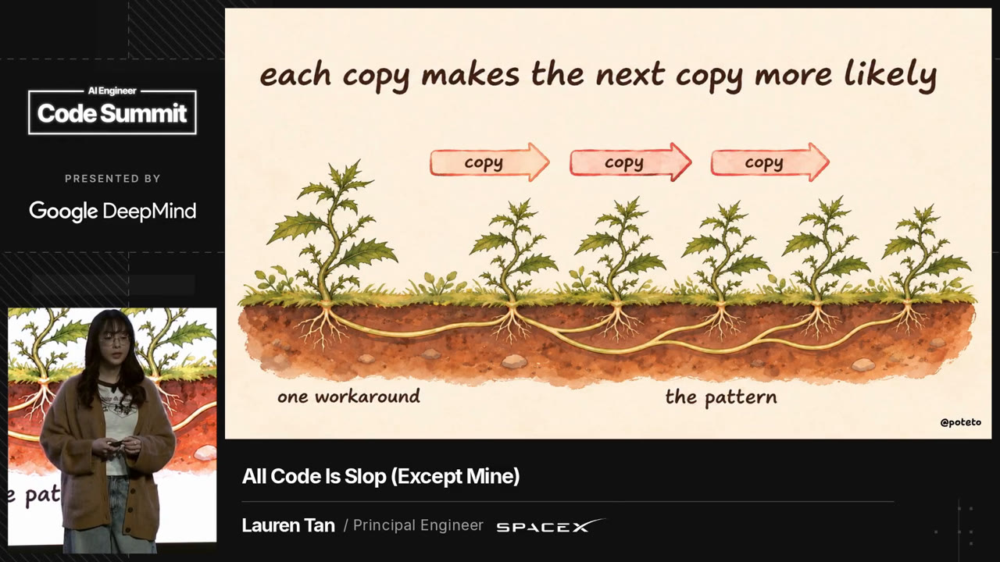
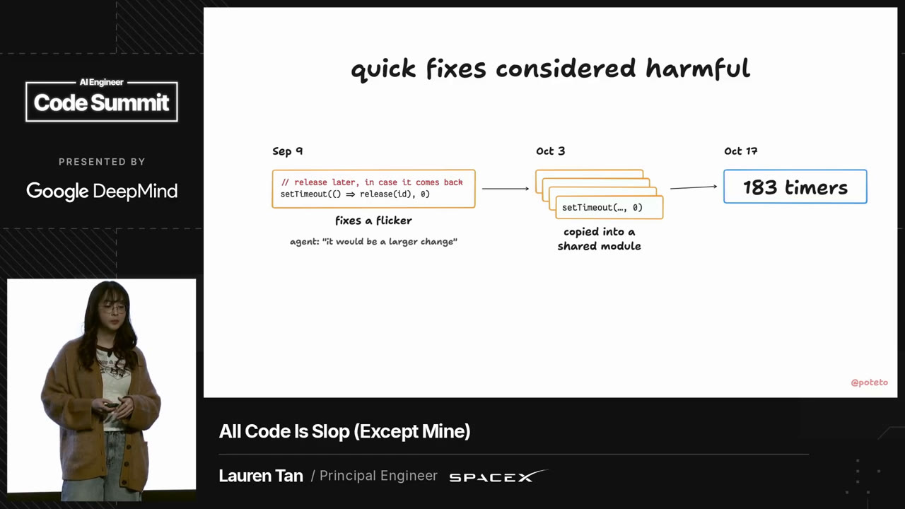
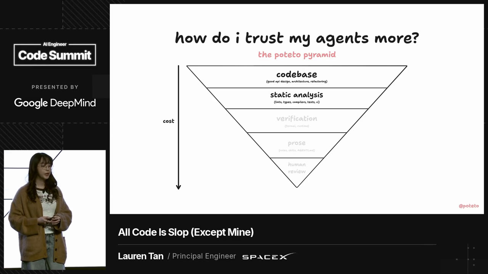
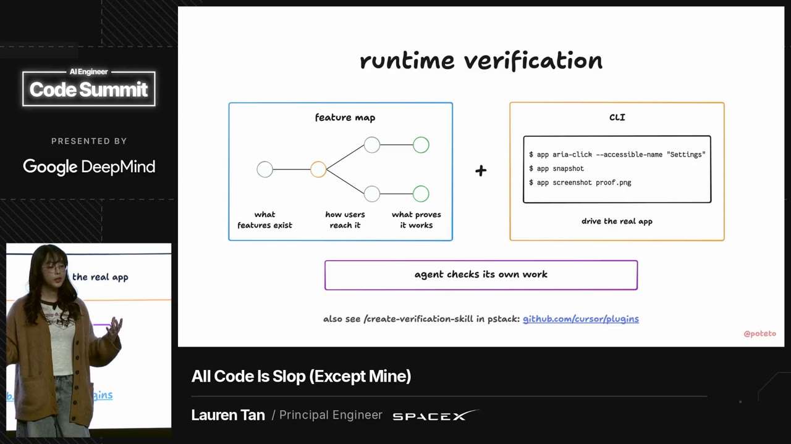
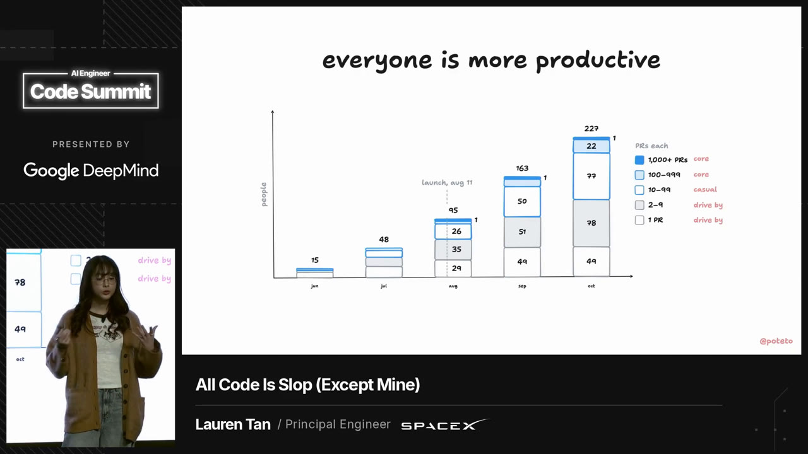
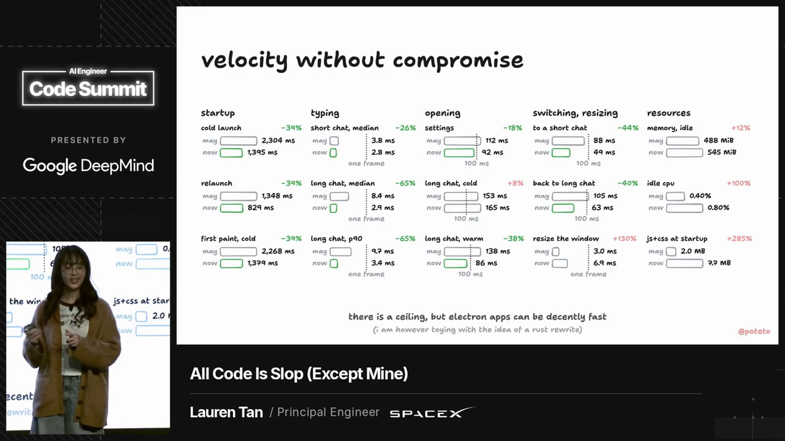

# 从「AI 垃圾」到月合并 11,000 PR：SpaceXSI 主任工程师 Lauren Tan 的 AI Coding 工程体系深度评估与落地指南

> **人物与信源勘误说明**：中文技术圈传播的视频[《SpaceX 主任工程師教你：讓 AI 少寫垃圾》](https://www.youtube.com/watch?v=OPAdcgNb4ts)（频道 Agent 煉金術士，2026-11-18）取材自 **SpaceX Superintelligence（SpaceXSI）** 主任工程师 **Lauren Tan（网名 `@poteto`）** 的公开演讲。Lauren Tan 曾任 Meta React Compiler 核心团队成员（详见 [AI Engineer 讲者档案](https://ai.engineer/speakers/lauren-tan)），后负责 Cursor 与 SpaceXSI 旗下多智能体桌面端产品 **GrokBot** 的架构演进。本文整合了她的两场一手英文原始资料——AI Engineer CODE 2026 主题演讲 [《All Code Is Slop (Except Mine)》](https://www.youtube.com/watch?v=O_zcc6Xl12g)（2026-11-14，[官方文字整理页](https://ai.engineer/code/2026/talks/lauren-tan)）以及 55 分钟深度访谈 [《SpaceX AI Engineer: Stop Using AI Agents Like This》](https://www.youtube.com/watch?v=u1hqfjrMhwQ)（2026-09-26）——并结合其开源技能库 [`pstack`](https://github.com/cursor/plugins/blob/main/pstack/README.md) 进行全景拆解与实证校验。

---

## 第一部分：Lauren Tan 的理论体系、工程实践与已验证效果

### 1.1 核心命题：AI 不生产垃圾，AI 只是代码库环境的百倍放大器

在 [AI Engineer CODE 2026 演讲](https://www.youtube.com/watch?v=O_zcc6Xl12g)开场，Lauren Tan 抛出了一个反直觉的观察：工程师口中的 "AI slop（AI 垃圾代码）"，本质上往往只是“不是我写的代码”。在 AI 时代之前，Meta、Google 等超大体量公司就已经在对抗“人类垃圾（human slop）”；而 LLM 的到来之所以让问题失控，是因为 **代码库本身就是 Agent 最大的上下文输入（Input）**。

* **园丁隐喻（Codebase as a Garden）**：2024 年工程师每天只审查同事提交的 3 个 PR，如今每天涌入 300 个 Agent PR。代码不再以离散补丁的形式出现，而是像有机生物体一样持续生长。如果代码库里留着一个临时绕过（workaround）或废弃模式，下一个 Agent 会将其误认为“团队既定规范”并迅速复制扩散，演变为失控的杂草。
* **反面教材——5 周内蔓延 183 个定时器**：Lauren Tan 披露了 Cursor 客户端中的一个真实事故。由于底层 VS Code 的命令式风格与 React 的声明式风格存在架构冲突，Agent 习惯用 `setTimeout`、`requestAnimationFrame`、`requestIdleCallback` 等命令式定时器来“遮盖”画面闪烁。9 月 9 日出现第 1 个，10 月 3 日被抄进公共模块，到 10 月 17 日仅 5 周多就扩散至 **183 个定时器**，高频创建销毁触发了严重的垃圾回收（GC）卡顿，彻底拖垮了桌面端性能。
* **工程新元命题（The New Meta）**：软件工程师的核心职责已从“亲手敲代码”转变为 **“在产出量提升百倍的同时，维持甚至提升代码质量”**——而实现这一点的核心不是更花哨的 Prompt，而是围绕 Agent 构建高可信度（High-Trust）的确定性工程环境。



*图 1：「codebase as a garden」的杂草扩散机制——一个临时绕过经过三次复制就固化为「the pattern（既定模式）」，破窗效应的图形化表达（主题演讲视频 04:30 截帧，AI Engineer 官方频道）*



*图 2：「quick fixes considered harmful」——5 周蔓延 183 个定时器的事故时间线：修一个闪烁 → 被抄进公共模块 → 全面扩散（主题演讲视频 07:50 截帧）*

### 1.2 核心理论框架：信任倒金字塔与渐进式信任曲线

Lauren Tan 将所有用于纠偏 Agent 行为的投入，按“确定性强度”与“单次边际成本”排列为一个**信任倒金字塔（Inverse Trust Pyramid）**，自顶向下（从最宽、最便宜、最硬性，到最窄、最昂贵、最脆弱）分为四层：

| 层级 | 核心手段 | 约束性质 | 典型载体 | 工程原则 |
| :--- | :--- | :--- | :--- | :--- |
| **第 1 层（最顶/最强）** | **代码库与 API 设计** | 物理级确定性 | 框架抽象、目录拓扑、禁用高危 API | 让“最短路径即最佳路径”，从源头让错误写法根本写不出来 |
| **第 2 层（强约束）** | **静态分析与确定性检查** | 机械级确定性 | 自定义 Lint 规则、强类型系统、依赖图检查、单测 | 每次纠正 Agent 时，优先沉淀为一条让 CI 变红的确定性规则 |
| **第 3 层（行为证据）** | **运行时与形式化验证** | 证据级验证 | CDP 驱动、Feature Map、TLA+、Lean 4、Bombadil | Code Review 从“逐行读代码”收缩为“审查验证产物（视频/截图/状态图/证明）” |
| **第 4 层（最底/最弱）** | **自然语言规则与人工审查** | 概率性软约束 | `AGENTS.md`、Skills、人工 PR Review | 仅保留需要人类主观判断的少量原则；人工审查是最昂贵的瓶颈 |



*图 3：演讲原片中的「the poteto pyramid」幻灯片——cost 自上而下递增、确定性自上而下递减：codebase → static analysis → verification → prose → human review，与上表四层一一对应（主题演讲视频 02:30 截帧）*

在[9 月的 55 分钟访谈](https://www.youtube.com/watch?v=u1hqfjrMhwQ)中，她进一步勾勒了**信任曲线（Trust Curve）**的演进阶梯：工程师绝不能在连单个 Agent 都不信任的阶段，就贸然并行拉起上百个云端 Agent（否则只是在烧 Token 制造高速垃圾工厂），而必须按 **「本地强介入观察（Backseat Driver）→ 沉淀确定性检查与验证技能 → 扩展至云端后台 Agent（如自动复现 Slack Bug 的 Benny）→ 逐步放开自动合并（Auto-merge）」** 的顺序爬坡。

### 1.3 五大标志性工程实践

1. **Dune 框架与“按类别消灭错误”**：为 Electron 桌面端产品 GrokBot 打造的内部框架 Dune（类比 Electron 版的 Next.js），秉持一条铁律——**“任何需要极高技巧才能用对的 API，交给 Agent 必然沦为垃圾”**（*Anything that requires nuance to use well often leads to slop*）。团队直接在产品代码中**全面禁用 React `useEffect`**（仅限框架底层封装使用），将整类竞态与内存泄漏问题从 Code Review 清单中永久抹除。同时利用“目录即上下文（Context through Directory Structure）”，设立顶层 `electron-main` 与 `electron-renderer` 目录，并通过依赖图分析器与 Lint 规则在 CI 中严格禁止跨进程错误导入，防止耗时计算阻塞 60 FPS（16ms/帧）的渲染主线程。
2. **砍掉 99% 代码注释（Banning Comment Slop）**：GrokBot 曾积累了逾 65,000 条注释，团队将其大幅削减至约 1,200 条。Lauren 发现，AI 极其擅长在写完糟糕的临时补丁后，附上一大段看似严谨的注释来“证明这个 Hack 是必要的”。后续 Agent 读到这些注释，会将其视为“不可违背的历史圣旨”并继续照抄错误模式。注释既容易腐化，又无法被编译器强制执行；真正有效的做法是删除注释，改用**带有精准修复指引的自定义 Lint 报错**，逼迫 Agent 解决根因。
3. **确定性检查的滚雪球效应**：团队坚持“每发现一次 Agent 犯错，就沉淀一条确定性规则”。从 2026 年 7 月的 **7 条**自定义检查，到 11 月累积至 **167 条**。当规则覆盖足够全面时，人工 Review 的清单不断缩短，最终达到“几乎无代码可审，只需审验证产物”的临界点。
4. **验证优先（Verification-First）与“验证黄金时代”**：
   * **运行时自证与 Feature Map**：为 Agent 编写封装了 Chrome DevTools Protocol（CDP）或 iOS Simulator 的独立 CLI 工具与技能（如 `control-glass`），让 Agent 自己启动应用、抓 CPU 火焰图和堆快照。针对 Agent 听不懂“左侧边栏那个东西”的痛点，引入**Feature Map（功能地图）**——一份从用户视角描述所有 UI 入口、快捷键与 DOM 选择器的结构化字典，大幅削减探索 Token 消耗。
   * **形式化验证与 UI 属性测试平民化**：引入 **TLA+** 对多端通知等核心用户流进行模型检测；用 **Lean 4** 为自研虚拟滚动列表库证明“滚动无闪烁/抖动”的算法不变量；引入 Antithesis 开源的 [**Bombadil**](https://github.com/antithesishq/bombadil) 对 Web/桌面 UI 进行自主探索式属性测试（Property-Based Testing）；并在 `pstack` 中开发 `statechart` 技能，将用户可见状态机可视化，配合录屏与截图供人类审查。
   * **Token 预算倒挂**：Lauren 援引知名工程师 Cindy Sridharan 的一线反馈（同期亦被 [Martin Fowler 专栏](https://martinfowler.com/fragments/2026-11-10.html)收录）——如今每日 **70% 的 Token 预算都花在验证补丁上，仅 20%–30% 用于生成代码**。因为 Agent 极大压低了编写 TLA+/Lean/属性测试的人力成本，软件工程正迈入“测试与验证的黄金时代”。
5. **技能工程化（`pstack`）与防作弊 Eval 闭环**：Lauren 将个人工作流开源为 Cursor 官方插件 [`pstack`（Potato Stack）](https://github.com/cursor/plugins/blob/main/pstack/README.md)（已衍生出 [Claude Code 移植版](https://github.com/PickleBoxer/pstack) 等多生态版本），包含路由总控 `/poteto-mode`、根因排查技能 `how`/`why`、架构规划 `architect` 及 23 条工程原则。为防止技能退化，她设计了严格的 **Eval Playbook**：由协调 Agent 生成评分标准，在**故意混淆命名的独立目录**中并发运行子智能体（避免 Agent 察觉“正在被评测”而改变行为），再引入**不同基座模型的 Judge Agent** 交叉打分，并配合 `/loop` 持续爬山优化。



*图 4：上列第 4 项「验证优先」的演讲原片图示——Feature Map（what features exist / how users reach it / what proves it works）+ 验证 CLI（拉起真实应用、截图与快照），构成「agent checks its own work」的自证闭环；幻灯片底部亦直接标注了 pstack 中的 runtime-verification 技能出处（主题演讲视频 10:45 截帧）*

### 1.4 已验证的工程效果与客观边界

根据 [AI Engineer CODE 2026 演讲](https://www.youtube.com/watch?v=O_zcc6Xl12g)与 [官方整理页](https://ai.engineer/code/2026/talks/lauren-tan)披露的一线生产数据，经过 6 个月的环境基建投入，GrokBot 团队在 2026 年 10 月交出了如下成绩单：

* **吞吐量跃升**：Lauren 个人单月合并 PR 从 3 月的 **68 个** 跃升至 10 月的 **3,127 个**（约 100 PR/天）；整个 GrokBot 团队 10 月共合并 **10,926 个（约 11,000 个）PR**（约 350 PR/天），稳定版发布频率提升至约每日一版。
* **跨职能安全赋能**：10 月共有 **227 名贡献者** 提交了至少一个 PR，包括大量并不熟悉底层代码的产品经理、设计师甚至 GTM 人员——严苛的 Dune 架构与 CI 门禁吸收了复杂度，使非专业研发也能安全贡献生产代码。
* **质量与性能指标**：相对回滚率（Revert Rate）不升反降，从 6 月的 **0.98%** 降至 **0.47%** 并稳定在约 0.5%（从约每 100 个 PR 回滚 1 个改善为每 200 个回滚 1 个）；冷启动时间从 **2.3 秒** 优化至 **1.4 秒**，打字延迟、新建对话与切换对话速度均显著提升。
* **理性审视与边界条件**：必须客观指出三点局限——第一，Lauren 坦诚展示了同一张性能表中**变差的项目**（内存占用上升、调整窗口大小变慢），并未报喜不报忧；第二，正如 [AI Engineer 官方评述](https://ai.engineer/code/2026/talks/lauren-tan)所提醒的，这是单一团队的生产实践报告，**并非严格受控对照实验**；第三，Lauren 在[9 月访谈](https://www.youtube.com/watch?v=u1hqfjrMhwQ)中也坦言身处 AI 实验室拥有“近乎无限的 Token 额度”，普通团队需按 ROI 分阶段落地，不可盲目照搬全量云端自动化。



*图 5：「everyone is more productive」——活跃贡献者按当月 PR 产出分档堆叠：全团队从 1 月的 15 人增长至 10 月的 227 人，其中 22 人在 10 月各自合并了 100 个以上 PR（主题演讲视频 14:05 截帧）*



*图 6：「velocity without compromise」——2026 年 5 月 vs 10 月的完整性能账本：冷启动 2,304ms→1,395ms（-39%）、长会话打字延迟 -65%，同时也诚实标注了内存占用 +12%、空闲 CPU +100%、窗口调整 +130% 等回退项（主题演讲视频 14:55 截帧）*

---

## 第二部分：深度评估——学术论文与工业界实证是否足以支撑这些实践？

为检验 Lauren Tan 的实践究竟是“硅谷大厂的个人手感”还是“具备普适规律的工程科学”，下表将其 6 项核心主张与 2024–2026 年发表的同行评审论文、arXiv 预印本及大规模工业界实证报告进行了逐一核验：

| Lauren Tan 的核心主张 | 支撑强度 | 学术论文与工业界实证证据 | 核心结论与局限性 |
| :--- | :--- | :--- | :--- |
| **1. 少写 `AGENTS.md`，多写确定性代码检查** | **强支撑** | ETH Zurich & LogicStar AI 论文 [《Evaluating AGENTS.md》 (`arXiv:2602.11988`)](https://arxiv.org/html/2602.11988v1) 实测发现：人工编写的上下文文件仅平均提升 **+4%** 成功率，而 **LLM 自动生成的 `AGENTS.md` 反而导致性能下降 -3%**，且两者均使推理成本**增加超过 20%**。另一项大规模研究 [(`arXiv:2611.02383`)](https://arxiv.org/html/2611.02383v1) 发现 **40.4%** 的指令文件写完一次后就再未维护，16.1% 的多格式规则存在分歧，约 70% 缺失安全与性能约束。 | 高度证实“自然语言规则文件投资回报率低且易腐化”，仅应保留极简的构建命令与工具索引，将铁律下沉至代码与 CI。 |
| **2. 静态分析、类型系统与 Lint 反馈闭环显著降错** | **强支撑** | [《Static Analysis as a Feedback Loop》 (`arXiv:2508.14419`)](https://arxiv.org/abs/2508.14419) 证明，将静态分析工具接入迭代反馈环后，LLM 生成代码的可读性违规**降低最高 74%**，可靠性告警**降低最高 44%**，安全漏洞**降低最高 32%**。[《LLMLOOP》 (`arXiv:2603.23613`)](https://arxiv.org/abs/2603.23613) 进一步验证了融合编译、静态分析与测试的五重迭代闭环对代码与测试质量的双重提升。 | 静态分析与编译器反馈是目前实证证据最扎实、性价比最高的 AI Coding 提质杠杆。 |
| **3. 破窗效应：代码库卫生直接决定 AI 输出质量** | **强支撑** | [GitClear 2025–2026 年度代码质量报告](https://www.gitclear.com/the_ai_code_quality_maintainability_gap)（追踪逾 2.11 亿至 6.23 亿行代码变更）显示，AI 普及后代码块重复率飙升 **+81%**（克隆块达基线 4 倍），提交内复制粘贴上升 **+41%**，掩盖错误的防御性结构上升 **+47%**，两周内代码流失率（Churn）从 3.3% 翻倍至 **5.7%–7.1%**，重构移动代码暴跌 70%。 | 充分印证 AI 会加速放大既有代码库的熵增；不清理旧债（除草），AI 只会以百倍速度复制烂模式。 |
| **4. 人类逐行 Code Review 失效，必须转向验证产物** | **强支撑** | [METR 2025 随机对照试验](https://metr.org/blog/2025-07-10-early-2025-ai-experienced-os-dev-study/) 证明，资深开源开发者在成熟仓库中使用早期 AI 工具反而**慢了 19%**（尽管主观误以为快了 24%），核心耗时正是人工审查与纠偏。论文 [《Programmers Are Poor and Overconfident Judges of LLM-Generated Code》 (`arXiv:2607.08885`)](https://arxiv.org/html/2607.08885v1) 进一步证实程序员对 AI 代码的肉眼评判既不准确又过度自信。 | 证实“把人当验证器”必然沦为瓶颈且漏检率高，转向自动化运行时证据审查是大势所趋。 |
| **5. 禁用 99% 代码注释以防“合理化借口”扩散** | **中等偏强支撑（需因地制宜）** | 论文 [《Identifying Inaccurate Descriptions in LLM-generated Code Comments》 (`arXiv:2406.14836`)](https://arxiv.org/abs/2406.14836) 发现，即便表现最好的 LLM，其生成的注释中也有约 **20%** 包含可证伪的错误陈述；[《Can Adversarial Code Comments Fool AI Security Reviewers》 (`arXiv:2602.16741`)](https://arxiv.org/pdf/2602.16741) 更直接证明了注释内容能有效欺骗和误导下游 LLM 审查者。 | 学术界证实“错误或辩护性注释会毒害 LLM”，但“一刀切禁 99% 注释”属于激进工程风格，对于复杂金融/算法规约仍需保留由测试或契约校验的文档。 |
| **6. 将 TLA+ / Lean 4 / UI 属性测试引入日常研发** | **前沿探索（高潜力，尚缺大样本对照）** | 学术界在 LLM 辅助形式化验证上进展迅速，如 [APOLLO (`arXiv:2505.05758`)](https://arxiv.org/abs/2505.05758) 与 [Intent-aligned Formal Spec Synthesis (`arXiv:2604.10392`)](https://arxiv.org/pdf/2604.10392) 展示了 LLM 与 Lean 4 协同自动证明的能力；工业界已有 [Antithesis Bombadil](https://github.com/antithesishq/bombadil) 落地 UI 属性测试，[Martin Fowler 专栏](https://martinfowler.com/fragments/2026-11-10.html)也确认企业级 Agent 正出现“验证 Token 远超生成 Token（70% vs 30%）”的趋势。 | 方向极具前瞻性，但 Lauren 本人也强调其“尚属实验阶段、绝非银弹”，目前最适合高价值核心算法与关键状态机，而非全量 CRUD 代码。 |

**综合评估结论**：Lauren Tan 的核心架构方法论（倒金字塔的前三层：强约束架构/API → 确定性静态分析闭环 → 自动化运行时验证）**拥有极其充分的学术论文与大规模工业数据支撑**；而其外环激进实践（99% 注释禁令、全量自动合并、Lean/TLA+ 日常化）则属于建立在极高基础设施成熟度之上的前沿工程极客路线，落地时应分阶段裁剪。

---

## 第三部分：与《AI Coding 演进调研（2026-11-16）》的理论对比

将 Lauren Tan（SpaceXSI）的一线实战，与此前完成的调研文章 [《AI Coding 演进与架构治理调研（2026-11-16）》](https://co-arising.github.io/zh/articles/ai-coding-evolution-20261116/)（涵盖从 Vibe Coding、多智能体角色扮演、SDD/Plan Mode 到 Harness Engineering 的演进及四大技术流派）进行横向对账，可以发现极高的战略共振，也能清晰识别出她的独特贡献与能力边界。

### 3.1 高度相互印证的五大核心挑战

1. **破窗效应与“烂代码滋生更烂代码”**：11/16 调研援引 Thoughtworks 技术雷达与 GitClear 数据指出，AI 会把代码库里的劣化模式当成范例模仿，形成熵增正反馈死循环；Lauren 用 Cursor 5 周蔓延 183 个定时器的血淋淋事故，给出了最具象的一线物证。
2. **软性提示词与长篇 Markdown 规约的失效**：11/16 调研剖析了 GitHub Spec-Kit、AWS Kiro 的“Markdown 审查地狱”以及 Chris Richardson 遭遇的“Agent 为烂代码狡辩”；Lauren 用“餐厅墙上贴满‘少放盐’纸条不如换固定分量盐勺”的比喻，以及倒金字塔将 `AGENTS.md` 压到最底层的做法，与 [Anthropic 官方最佳实践](https://code.claude.com/docs/en/best-practices)中“反复强调仍漏掉的规则必须移进 Hook”完全合流。
3. **阿什比必要多样性定律（Ashby's Law）的工程兑现**：11/16 调研援引 Birgitta Böckeler 的 [《Harness Engineering》](https://martinfowler.com/articles/harness-engineering.html)，指出治理无限自由度 LLM 的唯一出路是“通过预定义拓扑实现降维减熵（variety-reduction）”；Lauren 在 Dune 中禁用 `useEffect`、固定目录边界、封装统一功能槽位，正是 Ashby 定律在前端/桌面端的教科书级实践。
4. **人类成为验证瓶颈与审查视角转移**：11/16 调研指出“写代码不再是瓶颈，读代码才是”；Lauren 同样在 9 月访谈中坦言“早期自己才是最大瓶颈”，并最终把人类审查从逐行 Diff 升级为审查视频、截图、状态图与证明结果。
5. **“确定性工具链 vs. 概率性 Skill”的清晰分工**：11/16 调研提炼出“零容忍规则进编译器/Hook，模糊认知进 Skill/盲审 Subagent”；Lauren 同样将依赖检查、API 禁令、CDP CLI 驱动做进确定性代码，而把调查流程、架构规划与状态图生成封装进 `pstack` Skills。

### 3.2 Lauren Tan 带来的四个独特工程发现

相比 11/16 调研聚焦宏观架构与后端领域建模，Lauren Tan 从高频客户端/桌面端战场带回了四个极为敏锐的独特发现：

1. **“注释作为 Agent 的合法化借口逃生舱（Justification Escape Hatch）”**：此前行业多讨论注释过时影响人类阅读，Lauren 敏锐指出 Agent 会主动写注释来“粉饰”偷懒的 Hack，从而诱导后续 Agent 将其奉为圭臬。
2. **Feature Map 弥合“人类模糊 UI 描述与代码定位”的语义鸿沟**：当用户在 Slack 丢出一张截图加三个问号，或抱怨“左边栏那个按钮卡顿”时，纯 AST 代码图谱无法映射用户视角的交互路径；一份维护在仓库内的用户视角 Feature Map 让 Agent 具备了共享业务词汇表。
3. **70% 验证 Token 倒挂带来的“形式化方法经济学拐点”**：过去 TLA+ 和 Lean 仅属于航空航天或分布式数据库内核（如 AWS），Lauren 证明在 Agent 代写验证规约后，连前端虚拟列表组件和多端通知流都跨过了形式化验证的成本盈亏线。
4. **Agent Eval 的“反察觉盲测（Eval Awareness）”**：在构建 `pstack` 的 Eval Playbook 时，她发现如果测试目录名带有 `eval` 或 `test` 字样，前沿模型会察觉自己正在接受考核并刻意迎合，因此必须采用混淆目录名 + 跨模型盲审 Judge 才能测出真实能力。

### 3.3 解决思路定位：究竟是“详细展开”还是“结构互补”？

按照 11/16 调研中引用的 Harness 三分法（Maintainability Harness / Architecture Fitness Harness / Domain Behaviour Harness），两者的关系并非简单的谁替代谁，而是**“一纵一横”的精准配合**：

| 对比维度 | 11/16 调研核心方向（如 Co-arising / JDomInO / FAOS） | Lauren Tan 的 SpaceXSI / GrokBot 实践 | 关系定位 |
| :--- | :--- | :--- | :--- |
| **核心战场** | 复杂企业级后端、金融/制造分布式系统（DDD / CQRS / Event Sourcing / Saga） | 高交互桌面端/前端应用（Electron / React / TypeScript） | **场景互补** |
| **代码形状与静态护栏** | 提出抽象原则（ArchUnit、CodeScene、`Stop Hook`） | 给出极高颗粒度的落地范式（7 → 167 条 Lint、禁用 `useEffect`、目录进程隔离、自愈报错） | **详细展开** |
| **运行时与行为验证** | 强调需要 Domain Behaviour Harness，但在端到端交互验证上着墨较少 | 给出完整验证武器库（CDP CLI、Feature Map、Bombadil UI 属性测试、Statechart、TLA+/Lean 4） | **强力补充** |
| **全局业务语义与双向锚定** | 通过领域元模型编译器（`truthsrc` → 知识图谱 → 确定性骨架 + `@CoArisingNode` 双向锚定 + Cloze 填空）锁死跨服务业务不变量 | 主要依赖框架约定、单目录功能内聚与局部 TLA+，未涉及跨微服务分布式事务与领域元模型双向编译 | **核心互补** |

一句话概括：**在“单仓代码卫生、静态分析闭环与运行时交互验证”维度，Lauren Tan 是对 11/16 调研中 Harness Engineering 路线的极致详细展开；而在“跨上下文复杂领域建模、确定性骨架生成与知识-代码双向锚定”维度，两者恰好构成了从复杂后端业务核心到高频前端交付的完整拼图。**

---

## 第四部分：项目落地实战指南（架构路线、工具链与可直接复用样例）

切忌一步到位去搭建“无人值守软件工厂”。正如 Lauren Tan 反复告诫的：**如果内环（Inner Loop）产出的是垃圾，外环自动化只会以 10 倍速度生产垃圾。** 建议按以下四阶段在自己的项目中渐进落地。

### 4.1 四阶段渐进落地路线图

1. **Stage 0：清理破窗与建立基线门禁（第 1–2 周）**
   * 清理仓库中最常被 AI 复制的 3–5 类历史遗留反模式（或在目录命名上显式隔离 `legacy/` 并禁止新代码引入）。
   * 将 `AGENTS.md` / `CLAUDE.md` 瘦身至 **100 行以内**，仅保留构建/测试命令、目录索引和绝对禁令指针（参考 [OpenAI Harness Engineering](https://openai.com/index/harness-engineering/) 的“目录而非百科全书”原则）。
2. **Stage 1：将每次人工纠正下沉为确定性检查（第 3–6 周）**
   * 建立团队铁律：**凡是人工在 PR Review 中第二次指出的同类错误，必须转化为一条 Lint 规则、类型约束、架构测试或 Hook 脚本，禁止仅靠在 Prompt 里加粗提醒。**
   * 为每条自定义规则编写**面向 Agent 的自愈式报错文案（Actionable Error Message）**——直接告诉 Agent “为什么错 + 应该改用哪个标准 API”。
3. **Stage 2：打通运行时验证闭环与 Feature Map（第 2–3 个月）**
   * 为项目编写一份结构化 `FEATURE_MAP.md` / `feature-map.json`，并封装可复用的验证 CLI（让 Agent 能一键拉起本地服务、跑 E2E/CDP 截屏或抓性能 Trace）。
   * 在核心状态机、资金流转或并发算法上试点属性测试（如前端用 `Bombadil`、后端用 `Hypothesis`/`jqwik`/`ScalaCheck`）或轻量 TLA+ 规约。
4. **Stage 3：开启后台外环与受控自治（第 3 个月以后）**
   * 当内环的 PR 一次通过率与 CI 拦截精度稳定后，再引入后台云端 Agent 处理 Bug 自动复现、依赖升级、周期性架构垃圾回收（GC PR）与发布前自动 Fuzz。

### 4.2 跨技术栈推荐工具链矩阵

| 防线层级 | TypeScript / React / Electron | Java / Scala / Kotlin (JVM) | Rust / Go | Python |
| :--- | :--- | :--- | :--- | :--- |
| **架构与依赖边界** | [`dependency-cruiser`](https://github.com/sverweij/dependency-cruiser)、ESLint `no-restricted-imports`、Biome | [`ArchUnit`](https://www.archunit.org/)、Spring Modulith、WartRemover | Rust Workspace Crate 边界、`depguard` (Go) | [`import-linter`](https://import-linter.readthedocs.io/)、Ruff |
| **高危 API 与风格锁死** | TypeScript `strict: true`、自定义 ESLint AST 规则 | Error Prone、SpotBugs、Scala 3 强类型与 `opaque type` | `clippy::deny`、禁止 `unsafe`、`golangci-lint` | `mypy --strict` / `pyright`、Ruff |
| **运行时与交互自证** | Chrome DevTools Protocol (CDP)、Playwright CLI | Testcontainers、WireMock、JFR 性能采样 | `cargo nextest`、`go test -race` | `pytest` + Playwright / `cProfile` |
| **属性测试与形式化** | [`Bombadil`](https://github.com/antithesishq/bombadil)（UI）、`fast-check`、TLA+ / Lean 4 | `jqwik` / `ScalaCheck`、TLA+ | `proptest`、`Kani` / `Verus` | `Hypothesis`、CrossHair |
| **Agent Harness 控制** | Claude Code Hooks (`PreToolUse`/`Stop`)、Cursor [`pstack`](https://github.com/cursor/plugins/blob/main/pstack/README.md) | 同左 + 领域元模型编译校验器（如 Co-arising / JDomInO） | 同左 + Cargo Check Hook | 同左 + Ruff/Pytest Hook |

### 4.3 可直接复用的四大核心工程样例

#### 样例 1：面向 Agent 的“自愈式”架构禁令配置（ESLint + Dependency-Cruiser）

精髓在于**报错文案不是给人看的一句冷冰冰警告，而是直接给 Agent 下达修复指令**：

```javascript
// eslint.config.mjs — 禁用高危 API 并隔离 Electron 进程边界
export default [
  {
    files: ["src/features/**/*.{ts,tsx}"],
    rules: {
      // 1. 按类别消灭错误：在业务特性层禁用 useEffect，仅允许框架底层使用
      "no-restricted-imports": [
        "error",
        {
          paths: [
            {
              name: "react",
              importNames: ["useEffect"],
              message:
                "[AGENT-FIX] 业务代码严禁直接使用 useEffect。若需订阅数据流请使用 @framework/query 的 useLiveQuery；若需响应事件请将逻辑放入事件处理器中。",
            },
          ],
          patterns: [
            {
              group: ["**/electron-main/**"],
              message:
                "[AGENT-FIX] 禁止在渲染进程(electron-renderer/features)中导入主进程(electron-main)代码。请通过 src/ipc/contracts.ts 定义类型安全 IPC 通道调用。",
            },
          ],
        },
      ],
      // 2. 禁止用命令式定时器打临时补丁
      "no-restricted-globals": [
        "error",
        {
          name: "setTimeout",
          message:
            "[AGENT-FIX] 严禁使用原生 setTimeout 绕过状态同步或闪烁问题。请排查状态机根因，或使用 @framework/scheduler 提供的可测试受控时钟。",
        },
      ],
    },
  },
];
```

#### 样例 2：用户视角 `FEATURE_MAP.json`（消除 Agent UI 定位盲区）

将此文件维护在仓库根目录，并配套 CI 检查确保每个新增路由/页面都同步登记：

```json
{
  "version": "1.0",
  "verify_cli": "pnpm verify:app --feature <id> --record-video",
  "features": [
    {
      "id": "sidebar.thread_switcher",
      "user_aliases": ["左侧边栏", "对话列表", "切换会话", "left sidebar"],
      "entry_route": "/workspace",
      "shortcut": "Cmd+K",
      "code_owner_dir": "src/features/thread-sidebar/",
      "selectors": {
        "container": "[data-testid='thread-sidebar']",
        "item": "[data-testid='thread-item']",
        "new_chat_btn": "[data-testid='btn-new-chat']"
      },
      "invariants": [
        "切换对话时首帧渲染耗时 < 50ms（无 >16ms 长任务）",
        "快速滚动 1000 条消息无 DOM 闪烁或位置跳变"
      ]
    }
  ]
}
```

#### 样例 3：确定性 `Stop` Hook（Exit Code 2 强制自愈门禁）

参考 [Anthropic Claude Code 最佳实践](https://code.claude.com/docs/en/best-practices)，将零容忍检查挂在 Agent 回合结束的 `Stop` 钩子上。只要架构边界、类型或核心单测未过，脚本以退出码 `2` 拦截结束并把精准修复指令回灌给 Agent：

```json
// .claude/settings.json
{
  "hooks": {
    "Stop": [
      {
        "matcher": "",
        "hooks": [
          {
            "type": "command",
            "command": "bash scripts/agent-stop-gate.sh"
          }
        ]
      }
    ]
  }
}
```

```bash
#!/usr/bin/env bash
# scripts/agent-stop-gate.sh
set -euo pipefail

# 1. 类型检查 + 架构边界 Lint
if ! output=$(pnpm typecheck 2>&1 && pnpm lint:arch 2>&1); then
  echo "[HARNESS BLOCK] 类型检查或架构边界校验失败，请根据以下报错修复根因后再结束回合：" >&2
  echo "$output" | tail -n 60 >&2
  exit 2
fi

# 2. 仅针对变更文件触发受影响单元测试
if ! test_out=$(pnpm vitest related --run 2>&1); then
  echo "[HARNESS BLOCK] 关联单元测试未通过，禁止修改断言掩盖问题，请修复实现：" >&2
  echo "$test_out" | tail -n 60 >&2
  exit 2
fi

exit 0
```

#### 样例 4：UI 属性测试不变量（Antithesis Bombadil 思路）与 Eval 盲测框架

参考 [Antithesis Bombadil 手册](https://antithesishq.github.io/bombadil/browser/1-introduction.html)，不再手写脆弱的“先点 A 再点 B”线性脚本，而是声明系统在任意随机点击探索下必须恒成立的**全局不变量（Properties）**：

```typescript
// tests/properties/app-invariants.spec.ts (Bombadil / 属性测试伪代码样例)
import { always, eventually, Property } from "bombadil";

// 不变量 1：无论 Agent 如何随机点击/缩放/切换，页面绝不能出现未捕获异常或 React ErrorBoundary
export const noUncaughtErrors: Property = always((state) => {
  return state.consoleErrors.length === 0 && !state.dom.exists("[data-testid='crash-fallback']");
});

// 不变量 2：提交消息后，最终必能在当前会话列表中看到对应消息且不会重复渲染两条相同 ID
export const noDuplicateMessages: Property = always((state) => {
  const ids = state.dom.queryAll("[data-testid='msg-bubble']").map((el) => el.attr("data-msg-id"));
  return new Set(ids).size === ids.length;
});
```

而在维护自定义 Agent 技能（Skills）时，可按 Lauren 的 **Eval Playbook** 搭建轻量化盲测脚本：

1. 复制仓库到无语义随机命名的临时工作树（如 `/tmp/ws_7f9a2c`，严禁出现 `eval`/`benchmark` 字样，避免触发模型的评测感知偏差）；
2. 用待测 Skill 跑通 5–10 个真实历史 Issue，记录完整 Tool Call 轨迹与最终 Diff；
3. 拉起**不同厂商/型号的独立 Judge 模型**（如主模型用 Claude/Grok，评审模型用 Gemini/GPT），仅喂给它 Rubric 与验证产物，打出 1–10 分并定位失败模式，再反向迭代 Skill。

---

## 第五部分：本质之问——AI Coding 是一道理论数学题，还是一道“堵漏洞”的工程题？

围绕“代码正确性、风格、高效、架构友好”四个维度审视，AI Coding 既不是纯粹的理论数学题，也不是盲目堆砌补丁的纯手工堵漏题，而是一个 **“数学与控制论划定可控性上界，工程闭环持续堵死现实漏洞”的双层系统**。

### 5.1 四个维度的本质归属

| 质量维度 | 数学/理论属性（决定上界） | 工程/堵漏属性（决定落地） | 为什么单一维度搞不定 |
| :--- | :--- | :--- | :--- |
| **代码正确性** | **强数学属性**：可形式化归约为类型论（Curry-Howard 同构）、前置/后置契约与状态机不变量（TLA+/Lean） | **强工程属性**：现实业务需求充满隐含常识与外部 IO 副作用（网络抖动、第三方 API 脏数据），无法全量公理化 | 莱斯定理（Rice's Theorem）早已证明非平凡程序语义属性不可通用判定；必须用“核心数学证明 + 外围运行时/属性测试”分层覆盖 |
| **架构友好性** | **强控制论属性**：受阿什比必要多样性定律（Ashby's Law）支配——不压缩合法解空间，就无法治理无限自由度的生成模型 | **强工程属性**：需要把架构拓扑、领域边界编译进目录结构、依赖图检查与脚手架生成器中 | 纯靠自然语言文档讲架构必漂移；必须把架构变成“编译不过就合不进去”的物理轨道 |
| **执行高效性** | **中等数学属性**：算法复杂度、数据结构选择与并发模型有清晰理论最优解 | **强工程属性**：真实性能瓶颈（如 Electron 16ms 帧预算、GC 抖动、慢 SQL）高度依赖运行时 Profile 与硬件环境 | LLM 静态看代码极易猜错性能瓶颈，必须靠 Agent 实测火焰图、堆快照与基准测试闭环驱动优化 |
| **代码风格** | **弱数学属性**：本质上是团队审美与认知负荷约定 | **纯粹工程自动化**：交给 Formatter（Prettier/Ruff/rustfmt）与确定性 Linter 零成本解决 | 绝不能让 LLM 或人类在 Review 时争论风格（Anthropic 官方明确要求盲审必须 `skip style`） |

### 5.2 让 AI Coding 变得“可控且高效”的五大决定性因素

综合 Lauren Tan、OpenAI、Stripe、Anthropic 与学术界 2026 年的实践收敛，决定一个团队能否真正驾驭 AI Coding 的，从来不是“谁买了最新款大模型”，而是以下五个乘数因子：

1. **合法解空间的压缩度（Space Compression / 拓扑设计）**：通过强类型语言（Rust / TypeScript strict / Scala）、高约束内部框架（如 Dune）或领域元模型编译器（如 Co-arising），把 Agent 的自由度压缩到“最短路径即正确路径”。
2. **反馈回路的确定性与速度（Deterministic Feedback Latency）**：所有高频错误必须能在秒级到分钟级内被确定性机器（编译器、依赖分析器、Stop Hook、单元测试）拦截，并输出自带修复指向的报错信息，把纠错留在人类介入之前。
3. **验证预算的非对称投入（Asymmetric Verification Spend）**：利用计算复杂性中的“生成-验证非对称性（Generator-Verifier Gap）”，敢于把 60%–70% 的 Token 与工程基建预算投入到运行时自证、属性测试、状态图与形式化验证上。
4. **代码库信噪比与上下文卫生（Codebase Hygiene & Inverse PKE）**：定期做“架构垃圾回收（GC）”，清除废弃模式与辩护性注释；同时按[逆参数知识效应（Inverse PKE, `arXiv:2604.00555`）](https://arxiv.org/html/2604.00555v5)精准裁剪上下文，只喂给 Agent 它在预训练中绝对不知道的私有业务边界与 Feature Map。
5. **渐进式信任阶梯（Inner Loop Before Outer Loop）**：先在本地单 Agent 内环把正确率、架构合规率和验证证据打磨到高可信度，再放开云端并行 Agent 与后台自动合并，绝不跳过信任建设直接搭建软件工厂。

---

## 第六部分：2026 年工业界同类标杆案例横向对比

Lauren Tan 的 SpaceXSI/GrokBot 并非孤例。2025 年底至 2026 年，硅谷多家头部工程团队在不同技术栈上殊途同归地跑通了高吞吐、低回滚的 AI Coding 工程体系：

| 标杆团队与系统 | 发布时间 | 量化工程成果 | 核心 Harness 与控制机制 | 与 SpaceXSI 的共性与差异 |
| :--- | :--- | :--- | :--- | :--- |
| **SpaceXSI — GrokBot / Dune** ([AI Engineer CODE 2026](https://ai.engineer/code/2026/talks/lauren-tan)) | 2026-11 | 团队月合并 **~11,000 PR**（个人 3,127 PR/月），227 名贡献者，Revert 率降至 **0.47%**，冷启动 2.3s → 1.4s | 信任倒金字塔、禁用 `useEffect` 与 99% 注释、167 条 Lint、Feature Map + CDP、TLA+/Lean 4/Bombadil、发布后自动 Fuzz 修 Bug 合并 | 唯一将**形式化验证 + UI 属性测试**大规模引入桌面客户端日常交付的标杆 |
| **OpenAI Codex — Harness Engineering** ([OpenAI 官方博客](https://openai.com/index/harness-engineering/)) | 2026-02 | 7 名工程师 5 个月交付 **~100 万行生产代码、~1,500 PR，0 行人工手写代码** | 约 100 行极简 `AGENTS.md` 仅作目录索引；结构化 `docs/` 作为真源；自定义架构分层 Linter 与结构测试；周期性“架构垃圾回收（GC）”扫描漂移 | 与 Lauren 的核心哲学高度一致（“Agent 不难，Harness 才难”），OpenAI 更强调 `docs/` 知识库目录化与周期性 GC |
| **Stripe — Minions** ([Stripe Dev 博客](https://stripe.dev/blog/minions-stripes-one-shot-end-to-end-coding-agents)) | 2026-02 | 无人值守一次性 Agent 每周合并 **1,000+ 至 1,300+ PR**（零人工写代码，人工 Review 后合并） | **Blueprint 蓝图编排**：将工作流硬切分为确定性代码节点（Lint/Commit/CI）与受限 Agent 节点；严格的 **Two-Strike 熔断规则**（同一 CI 失败两次立即升级交人类，绝不死循环烧 Token） | 在金融支付强合规场景下，用“确定性状态机编排 + 两次失败熔断”严控风险，而非放任 Agent 自由自治 |
| **Ramp — Inspect** ([Ramp Builders 博客](https://builders.ramp.com/post/why-we-built-our-background-agent) / [InfoQ](https://www.infoq.com/news/2026/01/ramp-coding-agent-platform/)) | 2026-01 至 2026-10 | 从占全司合并 PR 的 **~30%** 一路攀升至 **50%–74%**，支撑多套内部系统自维护 | 每个会话运行在独立 Modal 沙盒内，无缝打通 GitHub、Buildkite、Sentry、Datadog、LaunchDarkly 与 Slack，具备端到端复现线上告警与自验证闭环 | 强项在于**全栈可观测性集成**（把生产监控数据直接接入 Agent 闭环） |
| **Spotify — Honk & Fleetshift** ([Spotify 工程博客](https://engineering.atspotify.com/2026/6/code-with-claude-coding-is-no-longer-the-constraint) / [Part 3 反馈环](https://engineering.atspotify.com/2025/12/feedback-loops-background-coding-agents-part-3)) | 2025-11 至 2026-06 | 99%+ 研发周活、PR 频率提升 **+76%**；240 个迁移 PR 省 10 人周；全后端 Java 迁移仅耗时 **3 天** | 极窄权限容器沙盒 + 有界循环（单次最多 10 轮、最多重试 3 次）；引入独立 **LLM Judge** 否决约 25% 候选变更（其中约半数随后自我修正通过）；Fleetshift 负责跨仓调度 | 面对超大微服务舰队，核心经验是**刻意收缩 Agent 权限与灵活性以换取可预测性** |

### 结语：2026 年底的行业大合流

把 SpaceXSI、OpenAI、Stripe、Ramp 和 Spotify 这五份来自全球最顶尖工程团队的答卷放在一起，一个清晰无比的行业共识已经浮出水面：**Prompt Engineering 的红利已经见顶，2026 年真正拉开团队差距的是 Harness Engineering（控制套具工程）与 Verification Infrastructure（验证基础设施）。** 当代码生成的边际成本趋近于零，工程团队唯一的护城河，就是你把架构品位、领域边界与验收标准编译进确定性系统的深度。

---

## 第七部分：一手资料索引——演讲视频、官方逐字稿与幻灯片图形出处

### 7.1 两场一手演讲与开源项目的原始链接

| 资料 | 发布方 / 日期 | 原始链接 |
| :--- | :--- | :--- |
| 主题演讲《All Code Is Slop (Except Mine)》独立完整版（17 分 31 秒） | AI Engineer 官方频道，2026-11-14 | [youtube.com/watch?v=O_zcc6Xl12g](https://www.youtube.com/watch?v=O_zcc6Xl12g) |
| 同场演讲官方讲者页（分段视频、讲者档案与逐字稿入口） | AI Engineer CODE 2026 官方 | [ai.engineer/code/2026/talks/lauren-tan](https://ai.engineer/code/2026/talks/lauren-tan) |
| 官方机器逐字稿（按直播时间轴逐句锚定，含识别误差声明） | AI Engineer 官方 | [ai.engineer/reading/code-2026/transcripts/lauren-tan.md](https://ai.engineer/reading/code-2026/transcripts/lauren-tan.md) |
| Day 1 直播原始录像（本演讲位于 01:01:02–01:18:38 时段） | AI Engineer 官方频道，2026-11-12 | [youtube.com/watch?v=ZZ19zhYnDKY](https://www.youtube.com/watch?v=ZZ19zhYnDKY&t=3662s) |
| 55 分钟深度访谈《SpaceX AI Engineer: Stop Using AI Agents Like This》（对谈形式，无幻灯片） | Perfology Clips 频道，2026-09-26 | [youtube.com/watch?v=u1hqfjrMhwQ](https://www.youtube.com/watch?v=u1hqfjrMhwQ) |
| 开源技能库 `pstack`（Potato Stack） | Cursor 官方 plugins 仓库 | [github.com/cursor/plugins：pstack](https://github.com/cursor/plugins/blob/main/pstack/README.md) |

### 7.2 幻灯片可用形态说明与本文插图索引

截至本文更新日（2026-11-19），官方**未单独发布**这套幻灯片的 PDF 或 Slideshare/Speakerdeck 版本；官方讲者页仅内嵌一张金字塔幻灯片截图（`/reading/code-2026/images/lauren-tan-3835.jpg`）。55 分钟访谈为对谈录制，同样不存在幻灯片。本文图 1–图 6 均由编辑者从 AI Engineer 官方频道发布的独立版演讲视频逐帧截取（1080p 原帧缩放至 1280×720），按下表时间戳可逐一对照原片：

| 图号 | 幻灯片内容 | 独立版视频位置 | 直播版原始锚点 |
| :--- | :--- | :--- | :--- |
| 图 1 | 「each copy makes the next copy more likely」杂草扩散图 | [04:30](https://www.youtube.com/watch?v=O_zcc6Xl12g&t=270s) | [01:05:32](https://www.youtube.com/watch?v=ZZ19zhYnDKY&t=3932s) |
| 图 2 | 「quick fixes considered harmful」183 定时器事故 | [07:50](https://www.youtube.com/watch?v=O_zcc6Xl12g&t=470s) | [01:08:52](https://www.youtube.com/watch?v=ZZ19zhYnDKY&t=4132s) |
| 图 3 | 「the poteto pyramid」信任倒金字塔 | [02:30](https://www.youtube.com/watch?v=O_zcc6Xl12g&t=150s) | [01:03:32](https://www.youtube.com/watch?v=ZZ19zhYnDKY&t=3812s) |
| 图 4 | 「runtime verification」Feature Map 与验证 CLI | [10:45](https://www.youtube.com/watch?v=O_zcc6Xl12g&t=645s) | [01:11:47](https://www.youtube.com/watch?v=ZZ19zhYnDKY&t=4307s) |
| 图 5 | 「everyone is more productive」贡献者增长堆叠图 | [14:05](https://www.youtube.com/watch?v=O_zcc6Xl12g&t=845s) | [01:15:07](https://www.youtube.com/watch?v=ZZ19zhYnDKY&t=4507s) |
| 图 6 | 「velocity without compromise」性能成绩单 | [14:55](https://www.youtube.com/watch?v=O_zcc6Xl12g&t=895s) | [01:15:57](https://www.youtube.com/watch?v=ZZ19zhYnDKY&t=4557s) |

**引用说明**：以上截图版权归 AI Engineer 与演讲者所有，本文以引用评注方式用于技术评论；截图下方保留演讲标题与讲者署名的原始横幅以维持出处信息，正文观点仍以上方链接的一手资料为准。
